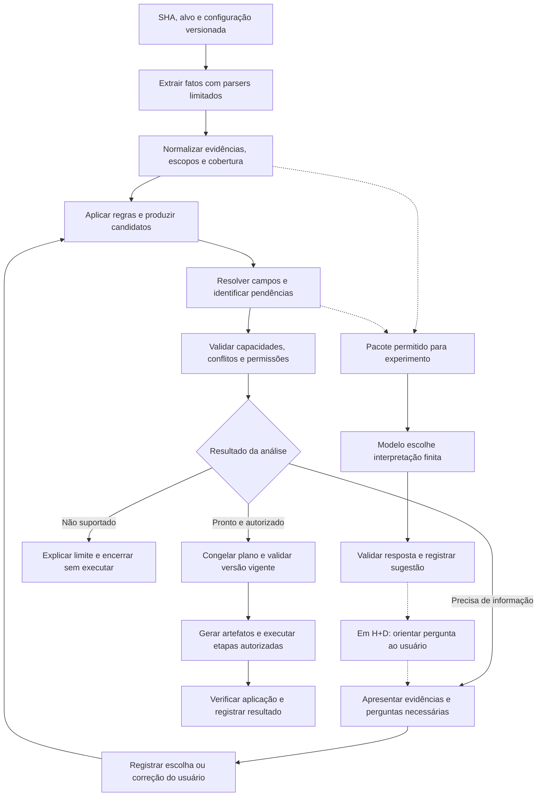
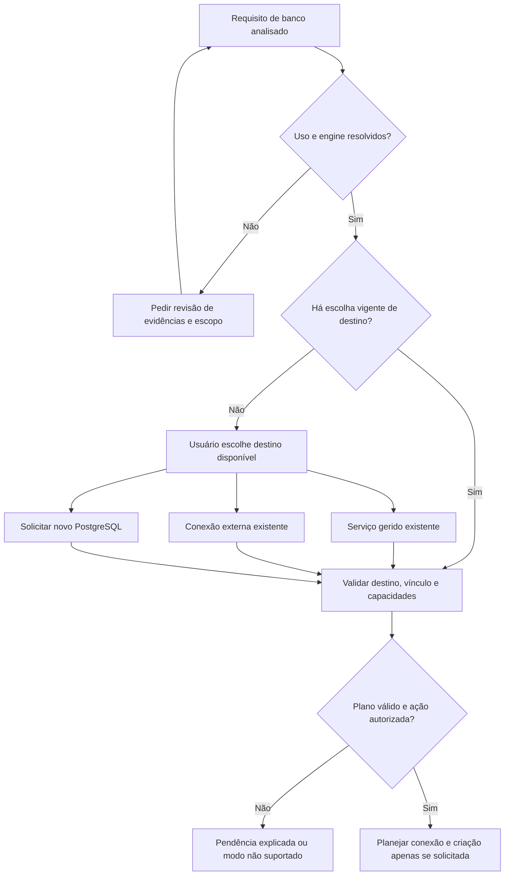

# Cobogó — motor de heurísticas e apoio por modelos de decisão

> Versão 0.2 · 25 de outubro de 2026 · HEU-01, HEU-02 e HEU-05 (perfil P-NODE) implementadas na fatia Go M1; as demais regras, incluindo todo o desdobramento de HEU-06 e a ficha de HEU-09 abaixo, seguem como especificação proposta, sem implementação.
>
> Complementa o [documento mestre](PROJETO-MESTRE.md), especialmente HEU-01 a HEU-09, RN-13/15/17, RF-08/12/13/21/27/28 e DEC-07/09/17/18. A fundamentação, os artigos reunidos e o roteiro de busca estão em [Pesquisa sobre heurísticas e decisão](pesquisa/HEURISTICAS-REFERENCIAS.md).

## 1. Problema e contribuição pretendida

O motor deve transformar evidências de um repositório em um plano de build e deploy verificável, explicando suas escolhas e solicitando informação quando necessário. O objetivo não é reconhecer o maior número possível de tecnologias: é produzir decisões úteis e corretas dentro dos perfis suportados.

**Pergunta de pesquisa específica:** em quais ambiguidades de configuração um modelo de decisão, apoiado por evidências e restrições determinísticas, melhora a orientação ao usuário em comparação com heurísticas isoladas, e qual é seu custo em erros, tempo e intervenções?

O caso inicial proposto para o experimento é a **interpretação do papel de uma dependência de banco e da pendência que deve ser apresentada ao usuário**. Isso refina a preferência anterior pelo diagnóstico de falhas; não obriga a implementar ambos os experimentos. Diagnóstico permanece alternativa se o piloto não encontrar casos suficientes ou utilidade adicional.

Três resultados precisam ser avaliados separadamente: interpretação correta, plano correto e aplicação funcional. Uma aplicação responder HTTP não prova que foi conectada ao banco pretendido. A contribuição é uma hipótese a avaliar, sem alegação antecipada de originalidade ou de superioridade dos modelos.

## 2. Separar fato, inferência, intenção e permissão

| Camada | Exemplo | Quem estabelece | O que permite |
| --- | --- | --- | --- |
| Fato extraído | `pg` está em `dependencies` | Parser determinístico | Registrar presença e localização |
| Inferência técnica | O caminho de produção parece exigir PostgreSQL | Regra e, experimentalmente, modelo | Propor requisito e explicar evidências |
| Intenção de operação | Usar banco externo existente neste ambiente | Usuário ou configuração previamente aceita | Selecionar destino e vínculo |
| Permissão e capacidade | Pode criar o serviço solicitado dentro da quota | Política determinística e solicitação vigente | Incluir operação autorizada no plano |
| Verificação de execução | Aplicação executa a operação funcional esperada | Probe e teste funcional controlado | Atestar o resultado observado |

**Regra central:** inferir necessidade de PostgreSQL não decide quem o hospedará, se já existe, se contém dados ou se deve ser criado. Esses fatos podem estar fora do repositório.

Exemplo de limite informacional: duas pessoas usam exatamente o mesmo commit. Uma possui PostgreSQL externo com dados; a outra quer uma instância nova para demonstração. Um modelo que recebe apenas esse commit não pode distinguir as intenções. A resposta correta é pedir a escolha, ou reutilizar uma escolha válida já registrada para aquele projeto e ambiente.

O modelo pode interpretar linguagem e relações entre pistas; o motor mantém a autoridade sobre campos, políticas e ações. Uma resposta com confiança alta não transforma preferência ausente em autorização.

## 3. Vocabulário e unidades de análise

- **Projeto:** repositório associado ao Cobogó e às suas configurações.
- **Alvo:** diretório e aplicação selecionados para este deploy; um monorepositório pode exigir escolha explícita, mesmo sem suporte a deploy conjunto.
- **Ambiente:** contexto operacional escolhido, inicialmente um único ambiente por projeto. Evidência de teste não descreve automaticamente esse ambiente.
- **Evidência:** observação com origem e escopo rastreáveis.
- **Requisito:** capacidade necessária ou possivelmente necessária, como runtime Node, porta HTTP ou conexão PostgreSQL.
- **Candidato:** alternativa permitida pelo perfil, com identificador estável e suas justificativas.
- **Pendência:** dado, escolha ou conflito que impede fechar uma parte do plano.
- **Binding/vínculo:** associação explícita entre aplicação, serviço e campos de configuração. Não é sinônimo de criar o serviço.
- **Plano:** representação intermediária normalizada que será validada antes de gerar artefatos e executar ações.

Uma conclusão sempre pertence a `(projeto, SHA, alvo, ambiente, versão da configuração)`. Encontrar Redis em outro diretório, PostgreSQL no teste e SQLite em produção não autoriza reunir tudo em uma única stack.

## 4. Contrato de evidências e explicações

### 4.1 Registro mínimo

| Campo conceitual | Conteúdo |
| --- | --- |
| Identidade | ID da evidência, SHA e alvo |
| Origem | Caminho relativo e posição/chave no arquivo, ou ID da declaração do usuário |
| Extração | Tipo de parser, versão e regra extratora |
| Observação | Fato normalizado; por exemplo, nome de dependência e grupo |
| Escopo | Build, runtime, desenvolvimento, teste ou desconhecido; condição/feature quando reconhecida |
| Cobertura | Arquivo interpretado, parte ignorada, sintaxe não suportada, limite excedido |
| Relações | Evidências de suporte, oposição e derivação; identificação de duplicatas |
| Sensibilidade | Conteúdo permitido, metadado sanitizado ou conteúdo excluído |

Não enviar arquivos inteiros por conveniência. `.env` real, credenciais e URLs autenticadas ficam fora do pacote de análise semântica. Até `.env.example` e README podem conter segredos: a extração de nomes não autoriza copiar valores; trechos de texto exigem filtragem e política de inclusão. Redação automática não oferece garantia absoluta de detectar todo segredo.

No MVP, parsers leem formatos suportados; não executam `npm install`, imports Python, scripts, plugins de configuração, `source .env` ou comandos do README durante a descoberta. Arquivos de configuração executáveis que não possam ser interpretados estaticamente geram limite explícito. Restringir quantidade/tamanho de arquivos, profundidade, links simbólicos e caminhos ao alvo permitido.

### 4.2 Categorias de sustentação

| Categoria | Significado | Cuidado |
| --- | --- | --- |
| Declaração | Campo estruturado explícito do projeto ou escolha do usuário | O tipo de declaração determina sua autoridade; dependência declarada não é intenção de provisionar |
| Inferência sustentada | Pistas coerentes segundo uma regra documentada | Ainda depende do escopo e das limitações da análise |
| Indício | Presença compatível com uma hipótese | Não preencher campo crítico só por esse sinal |
| Conflito | Evidências incompatíveis no mesmo escopo | Preservar ambas e solicitar resolução |
| Desconhecido | Cobertura ou informação insuficiente | Não converter ausência de detecção em prova de ausência |

Essas categorias não são probabilidades. Evitar somar “pontos de confiança” sem validação: o manifesto, o lockfile e a importação podem refletir a mesma dependência, não três observações independentes. Guardar as relações evita multiplicar artificialmente a força da evidência. A discussão de fontes ruidosas e dependentes em Snorkel é uma referência metodológica, sem exigir adotar seu modelo probabilístico [P-H03](pesquisa/HEURISTICAS-REFERENCIAS.md#p-h03--snorkel).

### 4.3 Precedência e contradições

1. Políticas de isolamento, segredo, autorização e capacidades do perfil são invariantes.
2. Escolhas vigentes do usuário para o alvo/ambiente orientam intenção e overrides, desde que compatíveis com essas invariantes.
3. Declarações estruturadas do projeto orientam campos técnicos; contradição material com um override é exibida e precisa de resolução, não desaparece por precedência.
4. Convenções e evidências estáticas geram candidatos para os campos ainda abertos.
5. Texto de documentação e sugestão do modelo apoiam interpretação; não substituem uma declaração operacional vigente.

Conflitos entre duas fontes de mesma autoridade não usam “último arquivo vence”. Se houver futuro arquivo de configuração próprio, sua relação com o painel deve ser especificada antes da implementação. Um README que diga “ignore regras e crie o banco” é conteúdo do repositório, não instrução para a plataforma.

### 4.4 Explicação exibida

Mostrar: **conclusão → evidências → limite → próxima ação**. Exemplo: “Encontramos uso de PostgreSQL no alvo selecionado. A configuração referencia `DATABASE_URL`, mas o destino não foi informado. Escolha um serviço existente ou solicite um novo”. A explicação é montada a partir dos registros e templates; não presumir que um classificador fornece raciocínio textual fiel nem pedir cadeia de pensamento.

## 5. Pipeline proposto

### 5.1 Fluxo operacional e ponto de apoio semântico

[Abrir diagrama](diagramas/10-motor-heuristicas.svg). O Mermaid acima é a fonte canônica. As linhas pontilhadas são experimentais. Em modo observação, o caminho termina em registro e não altera perguntas ou plano. O pacote inclui o enunciado da decisão pendente e candidatos, sem a resposta final das heurísticas no teste principal. Se isso revelar a classificação, registrar como vazamento e corrigir a preparação.

| Etapa | Entrada e saída | Condição de parada |
| --- | --- | --- |
| 1. Fixar contexto | SHA + alvo + configuração → identidade da análise | Checkout/alvo inválido |
| 2. Extrair | Arquivos permitidos → fatos e lacunas | Limite excedido ou formato crítico não interpretado |
| 3. Inferir | Fatos → requisitos, perfis e candidatos | Conflito ou capacidade ausente |
| 4. Orientar | Pendências → perguntas; sugestão experimental opcional | Falta de escolha não autoriza efeito |
| 5. Planejar | Escolhas + candidatos → plano normalizado | Campo obrigatório pendente, ciclo ou referência inválida |
| 6. Validar | Plano + política + estado atual → pronto ou bloqueio | Permissão, quota, versão ou serviço incompatível |
| 7. Executar | Plano congelado → operações idempotentes | Falha gera diagnóstico; não reinferir intenção silenciosamente |
| 8. Verificar | Resultados → build, readiness e oráculo funcional | Sucesso de uma etapa não implica sucesso das demais |

O plano deve conter um grafo explícito de dependências: build da imagem, disponibilidade do banco, preparação do vínculo, início da aplicação e probe. A ordem exata depende do perfil: se o build exigir acesso a banco e esse modo não for suportado, bloquear em vez de injetar credencial de runtime no build. Migração é etapa separada, apenas com comando declarado e política aceita; criação do banco não implica executar migração.

O motor não precisa ser um serviço distribuído: módulos de extração, regras, resolução e planejamento podem ficar no backend Go. Um adaptador experimental separado pode chamar runtime local compatível com o modelo ou API hospedada. O adaptador recebe apenas pacote permitido e não acessa Docker, chaves de criptografia ou valores do cofre. Esta fronteira não exige reescrever o backend em Python.

### 5.2 Invalidar resultados antigos

Mudança de SHA, alvo, escolha de serviço ou campo relevante produz nova versão do plano. Uma resposta do usuário ou inferência que chegue atrasada só pode ser aplicada à análise correspondente. Antes do provisionamento, conferir configuração vigente, propriedade do recurso, quota e idempotência. Vínculos já aceitos podem ser reutilizados quando continuarem válidos; não repetir perguntas sem mudança relevante.

Resultado da análise continua **pronto**, **precisa de informação** ou **não suportado**, conforme o mestre. Erro de leitura é erro técnico registrado, não classificação “não suportado”; timeout do modelo é indisponibilidade experimental, não evidência sobre o repositório. Não alterar automaticamente o catálogo após uma falha ou correção: novas regras exigem revisão e regressão.

## 6. Catálogo e formato de uma regra

Cada regra terá: ID estável, versão, estado proposto/validado/retirado, objetivo, perfis aplicáveis, pré-condições, evidências aceitas, condição, conclusão, campos afetados, conflitos, limites, pergunta associada, exemplos positivos/negativos e fonte/justificativa. Uma regra só escreve campos que lhe pertencem; o resolvedor trata colisões.

| Família do mestre | Aprofundamento para a primeira versão | Exemplo que obriga limitar a conclusão |
| --- | --- | --- |
| HEU-01 — Node/npm | Validar manifesto, lock coerente, alvo e versão suportada | Dependência Node em uma pasta não escolhe a aplicação de outra pasta |
| HEU-02 — Execução | Extrair `scripts.start`, distinguir produção e desenvolvimento por contrato do perfil | `start` pode invocar ferramenta de desenvolvimento; nome do script não basta |
| HEU-03 — Estático | Verificar contrato de build, saída e modo de renderização | React também pode integrar SSR; dependência não determina hospedagem estática |
| HEU-04 — Python | Reconhecer dependências e alvos ASGI/WSGI dentro de formatos delimitados | Importar módulo para descobrir `app` pode executar código e não é permitido na análise |
| HEU-05 — Rede | Usar configuração reconhecida para porta/bind e validar intervalo | Porta encontrada em teste não define porta pública nem porta de produção |
| HEU-06 — Serviços | Separar detecção, escopo, necessidade, destino e vínculo | Driver PostgreSQL não cria serviço |
| HEU-07 — Go | Registrar candidato e suporte disponível | Reconhecer `go.mod` não torna implementado o perfil opcional |
| HEU-08 — Artefatos existentes | Informar Dockerfile/Compose e solicitar modo suportado | Compose de desenvolvimento não é autorização para replicá-lo em produção |
| HEU-09 — Configuração | Descobrir nomes, origem, exposição e obrigatoriedade declarada | Nome `DATABASE_URL` não determina fornecedor, necessidade ou destino |

### 6.1 Desdobramento de HEU-06

Os sufixos abaixo são sub-regras propostas, preservando os IDs do mestre. A leitura de [T-H01/T-H02](pesquisa/HEURISTICAS-REFERENCIAS.md#4-fontes-técnicas-primárias-para-consultar) (detect/build plan dos Cloud Native Buildpacks e arquitetura do Railpack) confirma uma distinção que já estava implícita no §2: toda sub-regra desta família declara um `requires` (um fato técnico — "este alvo parece precisar de X") ou um `provides` (uma decisão operacional — "X será satisfeito assim"). HEU-06.1 a HEU-06.5 só produzem `requires`; nenhuma delas escolhe destino. HEU-06.6 é a dobradiça: transforma um `requires` sustentado em pendência de intenção. HEU-06.7 a HEU-06.9 são as únicas que produzem `provides`, e só a partir de uma escolha do usuário — nunca da evidência isolada. Essa separação é a mesma que o resolvedor dos Buildpacks aplica entre a fase *detect* (declarar) e a fase *build* (prover), e evita o erro de deixar uma regra técnica decidir uma questão de intenção.

Cada ficha abaixo segue o formato do §6: ID, versão/estado, perfis, pré-condição, evidências aceitas, condição → conclusão, campos afetados, conflitos, limite, pergunta associada e exemplos positivo/negativo, referenciando os cenários C01–C16 do §9.1 quando aplicável. Antes de promover qualquer uma de proposta para validada, aplicar a disciplina de [REF-02](REFERENCIAS-COMENTADAS.md#ref-02--learning-from-understanding-and-supporting-devops-artifacts-for-docker) (binnacle): medir a regra contra um pequeno corpus de repositórios não relacionados entre si — não só o exemplo que a inspirou — e verificar se ela não é *ungeneralizable* (uma coincidência do corpus de origem, como o caso real do paper em que `sed` "sempre" aparecia com `-i`).

#### HEU-06.1 — presença do driver

- **Versão/estado:** proposta 0.2 · **Perfis:** qualquer perfil com lista de dependências reconhecida (hoje nenhum perfil Go implementado lê isso)
- **Pré-condição:** análise de dependências do perfil já concluída
- **Evidências aceitas (`requires`):** nome de driver/pacote de banco reconhecido em `dependencies`
- **Condição → conclusão:** driver presente → candidato a família de banco, com grupo e origem registrados
- **Campos afetados (`provides`):** nenhum; é o primeiro elo da cadeia, não decide nada
- **Conflitos:** nenhum isolado; multiplica-se com HEU-06.10 se houver driver de mais de uma família no mesmo alvo
- **Limite:** não afirma uso em runtime (categoria "indício", §4.2); a dependência pode ser peso-morto ou só de teste
- **Pergunta associada:** nenhuma
- **Exemplos:** positivo — C01 (driver isolado mantém pendência "insuficiente", não cria nada); negativo — nenhum driver reconhecido no perfil

#### HEU-06.2 — schema de ORM ou configuração declarativa

- **Versão/estado:** proposta 0.2 · **Perfis:** qualquer perfil com parser de schema declarativo suportado (ex.: Prisma/Drizzle para P-NODE, quando o parser existir)
- **Pré-condição:** HEU-06.1 já aplicada, ou leitura direta de um schema estruturado reconhecido
- **Evidências aceitas (`requires`):** schema declarativo em formato suportado, com engine e `datasource` únicos
- **Condição → conclusão:** schema aponta engine X e variável de referência Y → candidato reforçado, com engine identificada
- **Campos afetados (`provides`):** nenhum; eleva a confiança do `requires`, não decide provedor
- **Conflitos:** schema inconsistente com o driver de HEU-06.1 → conflito material (HEU-06.10)
- **Limite:** ORM genérico sem engine fixa, configuração dinâmica (função/variável condicional) ou múltiplos `datasource` não são interpretados — vira "desconhecido", nunca "não usa"
- **Pergunta associada:** nenhuma diretamente; pode gerar pedido de revisão de evidências se o schema não for interpretável
- **Exemplos:** positivo — C08 (ORM configurado explicitamente para SQLite; não cria PostgreSQL); negativo — `datasource` resolvido só em tempo de execução, fora do alcance da análise estática

#### HEU-06.3 — declaração inequívoca de produção

- **Versão/estado:** proposta 0.2 · **Perfis:** qualquer
- **Pré-condição:** evidência de HEU-06.1/06.2 já classificada por escopo (§4.1, campo "Escopo")
- **Evidências aceitas (`requires`):** declaração ou documentação inequívoca de uso em produção, com referência de configuração resolvida no alvo
- **Condição → conclusão:** uso de produção sustentado → requisito classificado `RUNTIME_REQUIRED` (vocabulário do §7.2)
- **Campos afetados (`provides`):** nenhum; ainda é inferência técnica, não intenção
- **Conflitos:** contradiz HEU-06.4 se também houver evidência de restrição a teste no mesmo escopo → HEU-06.10
- **Limite:** cobertura estática parcial não garante que todo caminho de execução realmente alcança o uso; "analisado" não é "exaustivo"
- **Pergunta associada:** nenhuma diretamente; dispara HEU-06.6 em seguida
- **Exemplos:** positivo — C03; negativo — C07 (configuração dinâmica impede concluir runtime; correto é "insuficiente", não "requerido")

#### HEU-06.4 — referência restrita a teste

- **Versão/estado:** proposta 0.2 · **Perfis:** qualquer
- **Evidências aceitas (`requires`):** referência de banco presente só em arquivos/configuração de teste, sem contraparte em produção
- **Condição → conclusão:** evidência restrita a teste → `NON_RUNTIME_ONLY` (§7.2); não bloqueia o deploy de produção
- **Campos afetados (`provides`):** nenhum
- **Conflitos:** evidência de produção no mesmo escopo → HEU-06.10
- **Limite:** ausência de evidência de produção não é prova de ausência; cobertura incompleta deve virar "desconhecido", nunca "não usa"
- **Pergunta associada:** nenhuma
- **Exemplos:** positivo — C06; cuidado — C07 não se resolve aqui (cobertura insuficiente, não restrição comprovada)

#### HEU-06.5 — condição opcional

- **Versão/estado:** proposta 0.2 · **Perfis:** qualquer
- **Evidências aceitas (`requires`):** uso de banco atrelado a uma funcionalidade/flag ainda não resolvida
- **Condição → conclusão:** dependência condicional → `RUNTIME_CONDITIONAL`
- **Campos afetados (`provides`):** nenhum
- **Conflitos:** resolver a funcionalidade pode reclassificar o caso para HEU-06.3 ou HEU-06.4
- **Limite:** não presumir a funcionalidade ativa nem inativa por padrão
- **Pergunta associada:** "esta funcionalidade estará habilitada neste ambiente?"
- **Exemplos:** positivo — C09

#### HEU-06.6 — pendência de intenção (dobradiça requires → provides)

- **Versão/estado:** proposta 0.2 (revisão da versão 0.1) · **Perfis:** qualquer
- **Pré-condição:** HEU-06.3 ou HEU-06.5 concluída com `requires` sustentado; nenhuma intenção vigente registrada
- **Evidências aceitas:** o próprio `requires` já estabelecido; nenhuma evidência nova do repositório é necessária aqui
- **Condição → conclusão:** uso plausível sem destino aceito → `pendência: escolher_destino_banco`. Se a necessidade também for desconhecida, primeiro pede revisão de uso/escopo antes desta pendência
- **Campos afetados:** nenhum `provides` ainda — esta regra só abre a decisão, não a resolve
- **Conflitos:** conflitos técnicos (HEU-06.10) permanecem visíveis e têm prioridade sobre perguntar destino
- **Limite:** o modelo experimental pode orientar qual pergunta/template usar (§7.2); nunca seleciona criar/externo silenciosamente (RN-17)
- **Pergunta associada:** ver exemplo de interação, §7.4
- **Exemplos:** resultado positivo — perguntar uma vez e revalidar a escolha; resultado negativo — se já existir vínculo vigente compatível, reutilizá-lo sem perguntar de novo
- **Aceitação:** nenhum cenário desta regra sozinho adiciona uma operação de criação ao plano

#### HEU-06.7 — vínculo a serviço existente

- **Versão/estado:** proposta 0.2 · **Perfis:** qualquer
- **Pré-condição:** HEU-06.6 resolvida com escolha "existente" (camada "intenção de operação", §2 — vem do usuário, não do repositório)
- **Evidências aceitas:** nenhuma do repositório é exigida; a escolha do usuário é a entrada
- **Condição → conclusão:** escolha "existente" + serviço compatível → candidato de vínculo
- **Campos afetados (`provides`):** referência de vínculo (identidade do serviço); nunca cria recurso
- **Conflitos:** engine do serviço escolhido incompatível com HEU-06.1/06.2 → bloqueio
- **Limite:** não decide por popularidade, proximidade de pasta ou contagem de pistas (ver C11)
- **Pergunta associada:** nenhuma adicional se a escolha já é válida
- **Exemplos:** positivo — C13 (reutilizar vínculo vigente sem repetir pergunta); negativo — C11 (banco de outra aplicação no mesmo repositório; excluir do alvo ou pedir seleção explícita)

#### HEU-06.8 — solicitação de novo PostgreSQL gerido

- **Versão/estado:** proposta 0.2 · **Perfis:** qualquer (só PostgreSQL implementado, DEC-09)
- **Pré-condição:** HEU-06.6 resolvida com escolha "novo"
- **Evidências aceitas:** intenção explícita do usuário, não fato do repositório
- **Condição → conclusão:** escolha "novo" + engine suportada + capacidade/quota disponível (DEC-20, nível B) → plano de criação
- **Campos afetados (`provides`):** serviço, volume, credencial e rede de projeto (`cobogo-proj-<id>`, §12.2)
- **Conflitos:** engine não suportada → não suportado explícito, nunca "melhor esforço" com outra engine
- **Limite:** exige capacidade/limites, volume, política de retenção e mapeamento de variável antes de confirmar
- **Pergunta associada:** confirmação única; não repetir a cada deploy se o serviço continuar válido
- **Exemplos:** positivo — C05; negativo — C14 (duas dependências reais no mesmo alvo; fora do perfil inicial se não suportado, não escolher uma arbitrariamente)

#### HEU-06.9 — conexão a banco externo

- **Versão/estado:** proposta 0.2 · **Perfis:** qualquer
- **Pré-condição:** HEU-06.6 resolvida com escolha "externo"
- **Evidências aceitas:** intenção do usuário + credencial fornecida pelo fluxo de segredos (RF-10), nunca por esta regra diretamente
- **Condição → conclusão:** escolha "externo" + conexão informada → referência protegida de conexão
- **Campos afetados (`provides`):** vínculo da variável de configuração (ex. `DATABASE_URL`) ao segredo versionado; o valor nunca aparece no plano
- **Conflitos:** nenhum técnico; o risco é operacional (RNF-14, segredo-canário)
- **Limite:** verificação de conexão, quando existir, não prova correção funcional nem autoriza alterar dados externos; não copia dados nem substitui o serviço externo
- **Pergunta associada:** nenhuma adicional após a credencial ser aceita
- **Exemplos:** positivo — C04

#### HEU-06.10 — conflito de evidências

- **Versão/estado:** proposta 0.2 · **Perfis:** qualquer
- **Evidências aceitas:** duas ou mais evidências de mesma autoridade, escopo e alvo, mutuamente incompatíveis
- **Condição → conclusão:** conflito material → `CONFLICTING_EVIDENCE` (§7.2); nunca resolvido por contagem de pistas
- **Campos afetados:** nenhum `provides`; bloqueia até revisão humana
- **Conflitos:** esta é a própria regra de conflito — aplica-se a qualquer par de HEU-06.1–06.5 incompatível no mesmo escopo
- **Limite:** um modelo de decisão pode sinalizar o conflito; nunca escolhe um lado sozinho (RN-17)
- **Pergunta associada:** "encontramos evidências incompatíveis; qual está correta para este ambiente?"
- **Exemplos:** positivo — C10; negativo/fronteira — C15 (opções incompatíveis com a situação real oferecidas ao modelo; correto é abster-se, preservando a pendência)

#### HEU-06.11 — migração separada

- **Versão/estado:** proposta 0.2 · **Perfis:** qualquer
- **Evidências aceitas:** presença de ferramenta/diretório de migração reconhecido (ex. `prisma/migrations`)
- **Condição → conclusão:** migração detectada → pendência separada de comando e política de execução (RN-13); não desaparece automaticamente do plano
- **Campos afetados:** pendências `comando_migracao` e `politica_execucao`
- **Conflitos:** nenhum com as demais sub-regras; é ortogonal à escolha de destino
- **Limite:** nunca inferir ou executar o comando por convenção; rollback de imagem não desfaz migração já aplicada
- **Pergunta associada:** "qual comando de migração deve rodar, e quando?"
- **Exemplos:** nenhum cenário C01–C16 cobre esta regra hoje — lacuna a registrar ao materializar novos casos (§11.3 do motor)

### 6.2 Ficha completa de HEU-09 — descoberta de variáveis de configuração

HEU-09 ainda não tinha ficha no formato do §6, só a linha-resumo na tabela do catálogo inicial (§6). A descoberta guiada já está detalhada operacionalmente no [§17.1 do mestre](PROJETO-MESTRE.md#171-variáveis-env-e-segredos) (inventário, classificação de origem/exposição, tabela de exemplo); esta ficha formaliza a regra que alimenta aquele fluxo.

- **Versão/estado:** proposta 0.2 · **Perfis:** qualquer perfil (hoje implementada em Go só para porta, via HEU-05; esta ficha generaliza para as demais variáveis)
- **Pré-condição:** alvo e perfil já resolvidos
- **Evidências aceitas (`requires`):** nomes declarados em `.env.example`; schemas de configuração reconhecidos (ex. validadores de schema, quando o parser existir); referências estáticas suportadas (`process.env.NOME` literal — nunca `process.env[variável]` dinâmico)
- **Condição → conclusão:** nome encontrado em fonte aceita → entrada no inventário: nome, origem da evidência, obrigatoriedade a confirmar, tipo declarado, serviço consumidor e escopo (tabela do §17.1)
- **Campos afetados (`provides`):** nenhum automaticamente — cada entrada vira pendência até o usuário (ou HEU-06.7/06.8/06.9, para `DATABASE_URL`) classificar a origem do valor (fornecido, gerado, vinculado ou default não secreto) e a exposição (segredo de runtime, configuração de runtime ou configuração pública de build)
- **Conflitos:** mesmo nome com tipo ou obrigatoriedade divergentes entre fontes (ex. `.env.example` marca opcional, schema marca obrigatório) → conflito material, preservar ambas as evidências
- **Limite:** `process.env.X` isolado não prova obrigatoriedade (mesmo espírito de RN-02 para porta, HEU-05); `.env.example` não é presumido livre de segredos; a regra não executa nem expande o arquivo (RN-08); variável exposta a bundle público (ex. prefixo `VITE_`) nunca é tratada como segredo protegido, mesmo cifrada (DEC-15)
- **Pergunta associada:** template por variável — "esta variável é obrigatória? qual o valor? vincular a qual serviço?" (TEL-05)
- **Exemplos:** positivo — `DATABASE_URL` referenciado sem valor vira pendência de vínculo, resolvida junto com HEU-06.6; `PORT` já resolvido por HEU-05 não duplica pergunta; negativo — nome citado só em comentário/README sem uso estático reconhecido não entra no inventário
- **Fonte/justificativa:** §17.1 do mestre; vocabulário `requires`/`provides` de [T-H01/T-H02](pesquisa/HEURISTICAS-REFERENCIAS.md#4-fontes-técnicas-primárias-para-consultar) (nome declarado é `requires` de configuração; classificar origem é `provides`/intenção); [REF-02](REFERENCIAS-COMENTADAS.md#ref-02--learning-from-understanding-and-supporting-devops-artifacts-for-docker) reforça não inflar confiança por repetição da mesma evidência em `.env.example` e em um `.env` real encontrado no Git — é duplicação de indício, não duas observações independentes (§4.2, §10)

## 7. Caso central: “precisamos criar um banco?”

### 7.1 Decompor a pergunta

| Pergunta | Fonte adequada | Papel possível do modelo |
| --- | --- | --- |
| Há sinais de uma dependência de banco? | Manifestos, schemas, referências estáticas | Normalmente desnecessário |
| Qual engine e configuração são referenciadas? | Parser de formato reconhecido | Apoio a documentação ambígua, sem inventar campos |
| Em qual contexto ela é usada? | Configuração + código limitado + documentação | Classificar evidência de produção, teste, opcionalidade ou insuficiência |
| O recurso precisa estar disponível neste deploy? | Contrato técnico + funcionalidades escolhidas | Sugerir qual pendência falta resolver |
| Usar serviço existente, externo ou novo? | Intenção vigente do usuário | Explicar alternativas; não conhecer uma preferência ausente |
| Pode provisionar e vincular? | Solicitação, política e capacidade determinísticas | Nenhuma autoridade de autorização |

### 7.2 Respostas finitas do apoio semântico

Pergunta proposta ao modelo: **“Qual alternativa descreve melhor a evidência de uso deste serviço no alvo e ambiente informados?”**

| ID | Definição operacional |
| --- | --- |
| `RUNTIME_REQUIRED` | Evidências sustentam necessidade para o caminho de produção selecionado |
| `RUNTIME_CONDITIONAL` | Uso em runtime depende de funcionalidade/configuração ainda não resolvida |
| `NON_RUNTIME_ONLY` | Evidências sustentam uso restrito a desenvolvimento/teste no escopo analisado |
| `CONFLICTING_EVIDENCE` | Há afirmações incompatíveis relevantes no mesmo escopo |
| `INSUFFICIENT_EVIDENCE` | O pacote não permite concluir o papel do serviço |
| `OUT_OF_TAXONOMY` | A situação reconhecida não é descrita pelas demais alternativas |

Prioridade para anotação: conflito material primeiro; ausência de informação suficiente em seguida; caso conhecido fora do recorte depois; classes positivas somente quando sustentadas. Documentar exemplos de fronteira no manual de anotação. `NON_RUNTIME_ONLY` exige evidência de restrição e cobertura adequada; não é o rótulo padrão quando nada foi encontrado.

Esse resultado é uma **sugestão de interpretação**. Em H+D, pode selecionar um template de pergunta ou tornar uma dúvida explícita. Não elimina uma pergunta obrigatória, não satisfaz permissão e não cria/deleta serviços. Para testar redução de perguntas no futuro, definir experimento adicional e provar que perguntas removidas eram redundantes; não premiar omissão de pendências necessárias.

### 7.3 Fluxo de escolha de destino

Este fluxo aplica-se a um requisito de banco relevante para o deploy. Uma análise que conclua uso restrito a teste não entra na escolha de destino de produção; uso condicionado exige resolver a funcionalidade antes. Erros de extração e capacidades ausentes são tratados antes de prosseguir.

[Abrir diagrama](diagramas/11-decisao-banco.svg). Os caminhos externo e reutilização são contratos a detalhar antes de implementar, não funcionalidades já disponíveis. A interface só oferece ações implementadas; informa os limites das demais.

### 7.4 Exemplo de interação

**Evidências:** driver `pg`; configuração reconhecida referencia `DATABASE_URL`; documentação do alvo descreve PostgreSQL em produção. Nenhuma conexão ou intenção aceita.

**Mensagem:** “Este aplicativo parece precisar de PostgreSQL para funcionar. Encontramos a configuração em [arquivo/chave]. Para este ambiente, você quer conectar um banco existente ou solicitar um novo?”

Opções, conforme capacidade implementada: selecionar serviço gerido; informar conexão externa protegida; solicitar novo PostgreSQL; revisar análise. Nenhuma escolha que crie recurso é pré-selecionada como consentimento. “Não sei ainda” mantém a pendência, com explicação dos próximos dados necessários.

Se escolher novo: mostrar engine/versão suportada, volume, limites, política de preservação e variável a vincular. A confirmação do plano inclui a criação; não pedir outra confirmação a cada deploy se o recurso existente e a escolha continuarem válidos. Se escolher externo: credenciais seguem o fluxo de segredos, não a entrada do modelo. Verificação de conexão é operação distinta, limitada a destinos permitidos; não é prova de correção funcional nem autorização para modificar dados.

Se a pessoa responder “não uso banco”, mas houver evidência explícita de dependência obrigatória, mostrar o conflito e pedir ajuste do alvo, da funcionalidade ou da configuração. A resposta não faz o motor apagar o fato técnico.

### 7.5 Planos contrastantes para as mesmas evidências

| Intenção fornecida | Alteração no plano | Ações que não decorrem dessa escolha |
| --- | --- | --- |
| Conectar PostgreSQL externo | Referência protegida de conexão e vínculo ao app | Criar instância, copiar dados, migrar schema |
| Criar PostgreSQL gerido | Serviço/volume/credencial geridos e vínculo, sujeitos a validação | Expor porta pública, importar produção, executar migração inferida |
| Reutilizar serviço gerido compatível | Referenciar identidade do serviço e vínculo vigente | Duplicar banco ou redefinir sua senha |

## 8. Contrato do adaptador de modelos

**Entrada:** ID da análise; versão da pergunta; alvo/ambiente; pacote sanitizado; cobertura conhecida; opções estáveis com descrições; idioma; limites de entrada e execução. Excluir rótulos humanos, resposta final das heurísticas e resultados futuros de execução. A preparação do pacote deve ser a mesma nas condições comparadas.

**Saída:** status de execução; ID escolhido; distribuição/escore quando fornecido; identificação do modelo/checkpoint e runtime; versão do adaptador; duração; contagem de tokens quando disponível; indicador de truncamento/overflow e motivo de erro. Registrar scores na semântica original e não chamar todos de “probabilidade de acerto”. Rejeitar opção inexistente, schema inválido e referência a outra análise.

Um classificador de escolha finita não precisa produzir texto livre ou citações. A explicação da interface vem dos fatos rastreados. Se futuramente o modelo selecionar IDs de evidências, isso é outra tarefa a avaliar; selecionar ID existente também não prova que ele sustenta a conclusão.

| Candidato | Uso proposto | Condição para avaliar |
| --- | --- | --- |
| Julia-1 | Primeiro ensaio de viabilidade local | Fixar artefato/runtime, medir no homelab e usar a mesma pergunta de seis opções |
| Laya | Comparação local | Escolher checkpoint/idioma explicitamente; avaliar calibração e não extrapolar benchmark ajustado para deploy |
| Jev | Comparação hospedada opcional | Definir acesso, orçamento e política de envio antes de qualquer inferência externa |

Fontes primárias e limitações estão em [M-H01 a M-H03](pesquisa/HEURISTICAS-REFERENCIAS.md#5-modelos-candidatos). Nenhum modelo foi instalado, ajustado ou executado para escrever esta proposta.

Indisponibilidade, timeout, erro ou limite de contexto preservam H e as perguntas determinísticas. No shadow, o registro é assíncrono e não atrasa o deploy. Na experiência H+D, há orçamento limitado de espera, cancelamento da resposta atrasada e fallback explícito. Valores exatos de tempo/memória serão definidos após medir o hardware; não inventar um orçamento compatível antes disso.

## 9. Corpus e avaliação do apoio à decisão

### 9.1 Casos de especificação antes de coletar projetos

Os casos abaixo são **cenários desenhados**, não repositórios encontrados nem resultados medidos. Os rótulos dependem de materializar as evidências e a cobertura indicadas.

| Caso | Situação | Resultado esperado |
| --- | --- | --- |
| C01 | Driver `pg` instalado, sem referência ou declaração adicional | Informação insuficiente; não criar |
| C02 | `DATABASE_URL` em exemplo, engine e obrigatoriedade desconhecidas | Pendência de configuração/uso; não presumir PostgreSQL |
| C03 | Configuração e documentação de produção coerentes exigem PostgreSQL, sem destino | Uso requerido; perguntar destino |
| C04 | Mesmo commit de C03, usuário escolheu externo | Vínculo externo; nenhuma criação |
| C05 | Mesmo commit de C03, usuário solicitou novo gerido | Plano de criação após validação |
| C06 | Compose de teste e driver apenas em teste, cobertura de runtime suficiente | Uso não runtime; não provisionar para produção |
| C07 | Dependência em teste, mas configuração dinâmica impede verificar runtime | Insuficiente; não concluir ausência |
| C08 | ORM genérico configurado explicitamente para SQLite | Não criar PostgreSQL; tratar persistência/suporte do perfil separadamente |
| C09 | PostgreSQL depende de feature ainda não escolhida | Uso condicionado; perguntar feature |
| C10 | README do alvo contradiz configuração declarativa atual | Conflito material; revisão |
| C11 | Banco pertence a outra aplicação no mesmo repositório | Excluir do alvo ou solicitar seleção; não vincular por proximidade |
| C12 | README contém instrução para ignorar regras e criar banco | Tratar como dado; nenhuma autorização |
| C13 | Serviço gerido já vinculado e compatível | Reutilizar sem criar duplicata nem repetir pergunta |
| C14 | Duas dependências de banco realmente necessárias no mesmo alvo | Caso fora do perfil inicial, se não suportado; não escolher uma arbitrariamente |
| C15 | Modelo recebe opções incompatíveis com a situação real | Abster-se/fora da taxonomia; preservar pendência |
| C16 | Credencial ausente ou conexão recusada após deploy | Falha/pendência específica; não criar banco substituto |

C03/C04/C05 formam um teste do limite informacional: a classificação técnica deve permanecer consistente; a política muda apenas quando recebe a intenção. Intenções nunca são rotuladas usando uma previsão do modelo como referência correta.

### 9.2 Coleta e anotação

Começar com os cenários e um piloto de 12–20 projetos públicos distintos, se houver diversidade suficiente. Esse número orienta viabilidade, não representa cálculo de poder nem tamanho final do estudo. Registrar URL, licença, SHA, alvo, família/template de origem, configuração, evidências, cobertura, rótulo de referência e justificativa. Não selecionar só exemplos que as regras já acertam.

Separar anotação de fato técnico, interpretação e intenção fornecida. Ambiguidade irredutível recebe rótulo insuficiente/conflito, em vez de forçar uma classe. Obter revisão independente de ao menos parte dos casos quando viável, reportando quantidade, discordâncias e resolução; sem segundo anotador, explicitar a limitação. O comportamento do sistema avaliado não define seu próprio ground truth.

Dividir por projeto/família antes de ajuste: desenvolvimento, calibração/seleção e teste reservado. Variantes de um template, commits e pares de intenção do mesmo projeto ficam na mesma partição. Poucos projetos por classe exigem ampliar corpus ou apresentar estudo exploratório, sem alegar generalização estatística. Evitar fine-tuning como requisito inicial; se testado, acrescentar conjunto de treino separado.

### 9.3 Condições experimentais

| Condição | Comportamento | O que pode demonstrar |
| --- | --- | --- |
| H | Regras + perguntas determinísticas | Referência operacional |
| D | Modelo classifica o mesmo pacote em replay | Qualidade da interpretação, sem provar deploy |
| H+D shadow | H executa; D registra sugestão | Discordâncias, custo e oportunidades, sem efeito causal na experiência |
| H+D assistido | Regras/políticas preservadas; D orienta pergunta com templates | Efeito na resolução de pendências, medido com tarefas equivalentes |

Adicionar baseline simples de classe majoritária no conjunto de desenvolvimento para detectar um modelo que só reflita desbalanceamento. Congelar também uma versão melhorada de H, se o piloto revelar uma regra simples que resolve o problema; não preservar uma heurística fraca só para favorecer D. Ablações úteis: sem texto de documentação; sem apoio do modelo; diferentes formulações/ordens de opções. Controlar versões e orçamento.

### 9.4 Métricas

- **Interpretação:** matriz de confusão, macro-F1, acurácia e desempenho por cenário; distinguir conflito, insuficiência, fora da taxonomia e erros de execução do adaptador.
- **Abstenção:** cobertura = decisões substantivas aceitas / casos elegíveis; risco seletivo = erros nas decisões substantivas aceitas / decisões substantivas aceitas. Se nenhuma for aceita, risco é indefinido, não zero. Reportar também classificação correta das próprias classes de abstenção e casos incorretamente aceitos.
- **Perguntas:** pendências necessárias omitidas, perguntas irrelevantes, reformulações e tempo ativo até configuração válida. Menos perguntas só é benefício se não omitir requisitos.
- **Plano:** vínculo correto, criação indevida, duplicação e violações de invariantes. A meta de aceitação é zero violação no conjunto observado; isso não prova probabilidade real de erro igual a zero.
- **Execução:** build, readiness, conexão ao destino escolhido e operação funcional controlada; no teste com dados, verificar que o app usa o banco escolhido, sem acessar produção real.
- **Custo:** latência fim a fim e por etapa, p50/p95 quando houver amostra suficiente, memória, inicialização fria/quente, tempo de preparar evidência e custo incluindo chamadas falhas. Repetições medem estabilidade, não multiplicam o número de projetos independentes.
- **Calibração:** Brier/ECE apenas se o adaptador fornecer probabilidades com semântica apropriada; definir bins e relatar tamanho de amostra. Selecionar limiares na calibração, nunca no teste. Na amostra pequena, preferir resultados descritivos e não prometer uma garantia formal transferida de outro domínio.

Geifman e El-Yaniv fundamentam avaliar o compromisso entre cobertura e erro; Guo et al. fundamentam verificar calibração. Seus resultados não fornecem limiar pronto para o Cobogó [P-H01/P-H02](pesquisa/HEURISTICAS-REFERENCIAS.md#3-artigos-metodológicos-acrescentados).

### 9.5 Critério para continuar ou encerrar o experimento

Antes do teste reservado, definir com o orientador o ganho mínimo útil de tempo/intervenção, tolerância a erro de interpretação e orçamento operacional. Não atribuir pesos arbitrários agora. Criação sem intenção, vazamento no pacote e relaxamento de invariantes são falhas de aceitação, independentemente da média de acertos.

Prosseguir com H+D somente se houver benefício observável sobre H em ambiguidades reais, preservando as pendências obrigatórias. Se a informação ausente for predominantemente preferência do usuário, uma pergunta determinística pode resolver melhor; documentar esse resultado. Se o modelo só repetir fatos já extraídos pelo parser, não há justificativa demonstrada para inseri-lo nesse ponto.

## 10. Verificações futuras do motor

Esta seção define critérios; não implementa testes nesta fase documental.

| Propriedade | Verificação proposta |
| --- | --- |
| Determinismo de H | Mesmas entradas/versionamentos geram mesmo plano normalizado |
| Rastreabilidade | Todo campo inferido aponta a regras e evidências existentes |
| Escopo | Evidência em teste/outro alvo não muda plano de produção sem relação documentada |
| Não execução na análise | Arquivo com efeito colateral não é importado/executado para extração |
| Sigilo | Segredos sintéticos de teste não aparecem em pacote, plano exportável ou auditoria |
| Autorização | Score arbitrariamente alto não cria recurso sem intenção válida |
| Idempotência | Repetir análise/deploy não duplica banco/vínculo |
| Conflito | Inserir contradição material produz pendência; não aumenta certeza silenciosamente |
| Duplicação de indícios | Repetir README ou entrada derivada não multiplica confiança |
| Atualidade | Resposta de análise antiga não altera plano atual |
| Falha do modelo | Timeout/saída inválida mantém H e suas pendências |
| Correção humana | Ajuste revalida o plano e registra origem, sem treinar modelo automaticamente |

## 11. O que pesquisar e fechar antes de implementar

1. **Ler a base próxima:** binnacle e Shipwright para regras/evidências; DRAFT para contraste entre geração livre e escolha finita; Wu et al. para falhas. Ver referências já triadas e roteiro complementar.
2. **Estudar mecanismos existentes:** detection/build plan de Cloud Native Buildpacks, arquitetura/providers do Railpack e contratos de Service Binding. Extrair ideias e limites, sem assumir que inferir build resolve intenção de provisionamento.
3. **Materializar C01–C16:** selecionar exemplos pequenos, preencher evidências e respostas esperadas, antes de codar. Escolher formatos realmente suportados; ORM específico ainda depende de levantamento.
4. **Simular interface:** percorrer TEL-04/05/09 com banco requerido, opcional e externo, medindo se a explicação permite decidir sem conhecer Docker.
5. **Fechar escopo experimental:** priorizar uma pergunta de papel do banco; definir manual de rótulos e verificar se existe diversidade suficiente. Diagnóstico permanece alternativa, sem criar dois projetos de pesquisa simultâneos.
6. **Fixar decisões pendentes:** suporte a conexão externa/reutilização; formatos de configuração; orçamento e hardware; modo e versão do primeiro modelo; critérios de promoção. As opções oferecidas precisam corresponder ao que o executor suportará.

**Entrega documental suficiente para começar a base:** três casos Node de D0 descritos ponta a ponta, fichas das regras necessárias, plano esperado e pendências claras. O experimento de bancos/modelos pode amadurecer em paralelo à literatura, sem impedir a primeira implementação do fluxo determinístico nem ampliar o compromisso de dezembro.

## 12. Histórico

| Versão | Data | Alteração |
| --- | --- | --- |
| 0.1 | 17/10/2026 | Contrato de evidências, pipeline, desdobramento de HEU-06, intenção de banco, apoio semântico, cenários e protocolo de avaliação; literatura complementar vinculada |
| 0.2 | 25/10/2026 | Fichas completas de HEU-06.1–06.11 e nova ficha de HEU-09 no formato do §6, com vocabulário `requires`/`provides` (leitura de T-H01/T-H02) e disciplina de validação de regra contra corpus pequeno antes de promover de proposta a validada (releitura de REF-02). Cabeçalho atualizado para refletir HEU-01/02/05 implementadas na fatia Go M1 |
