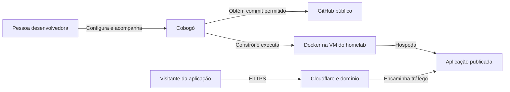
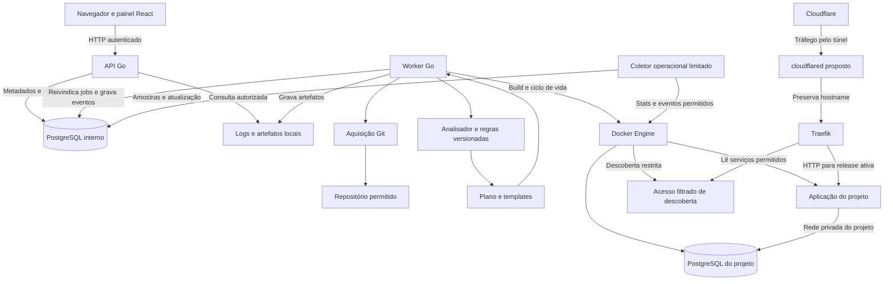
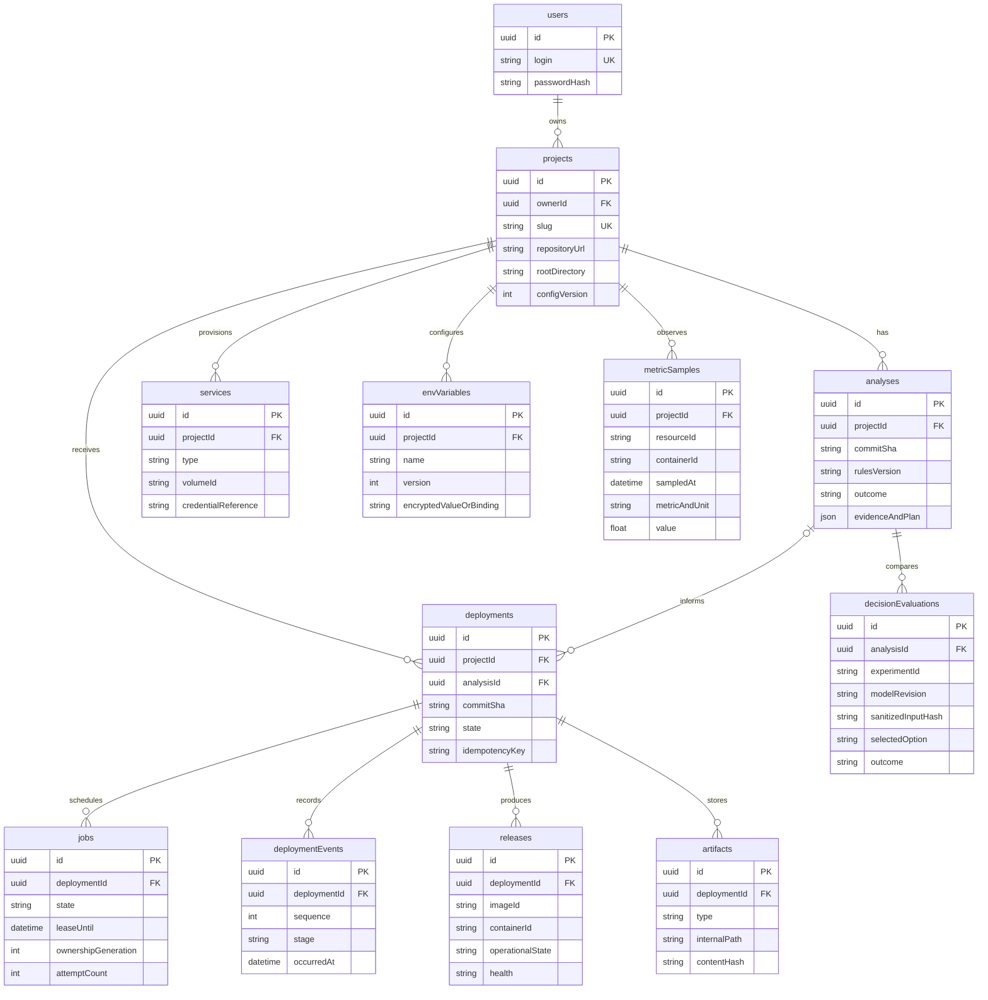
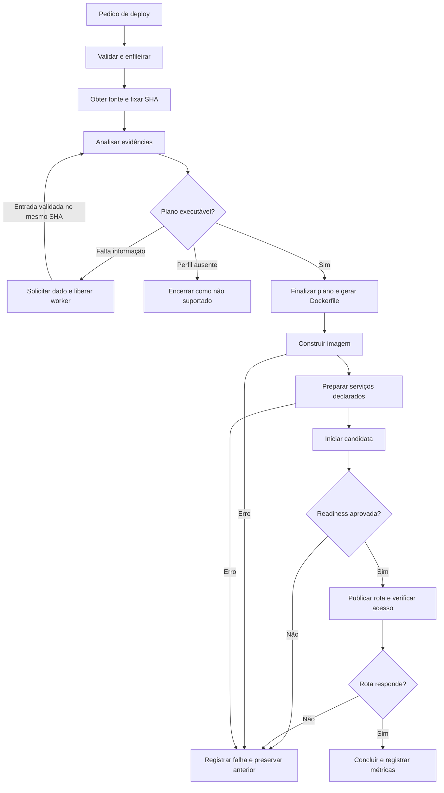
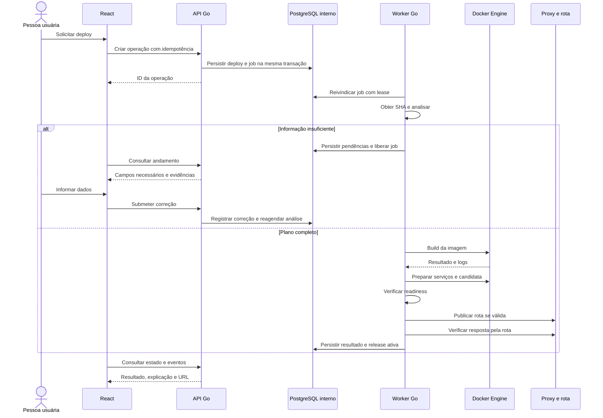
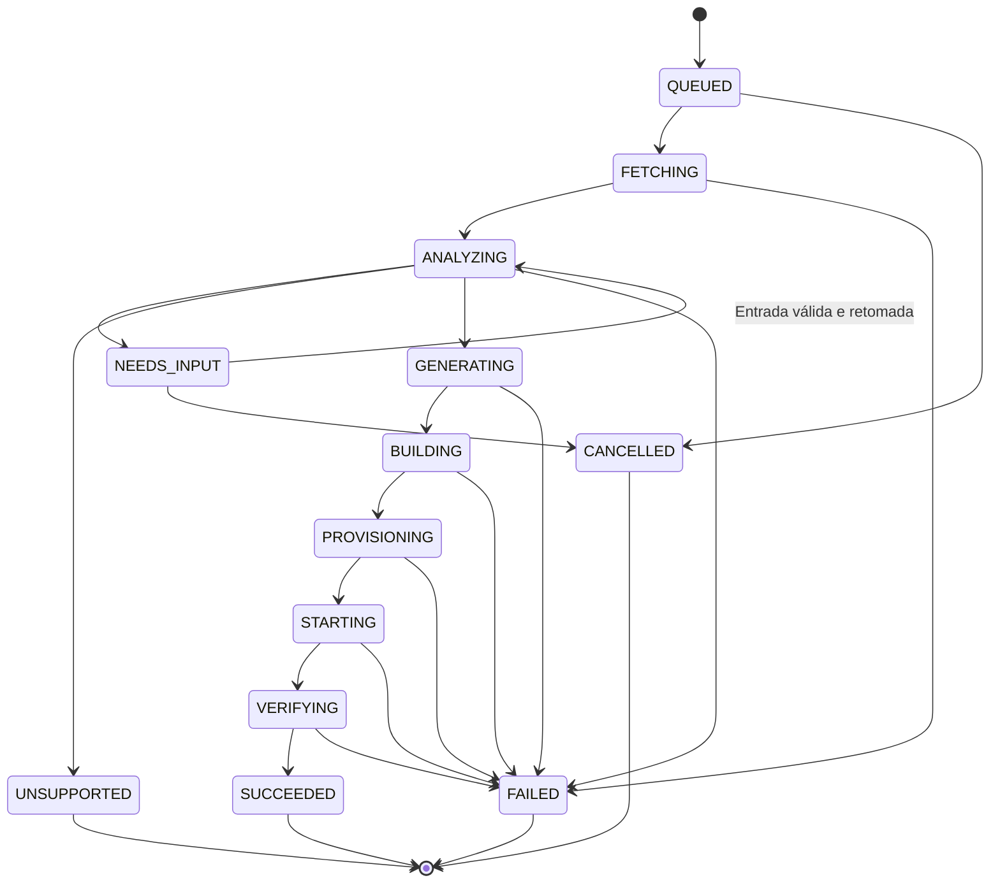
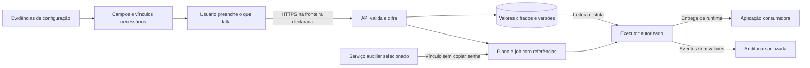
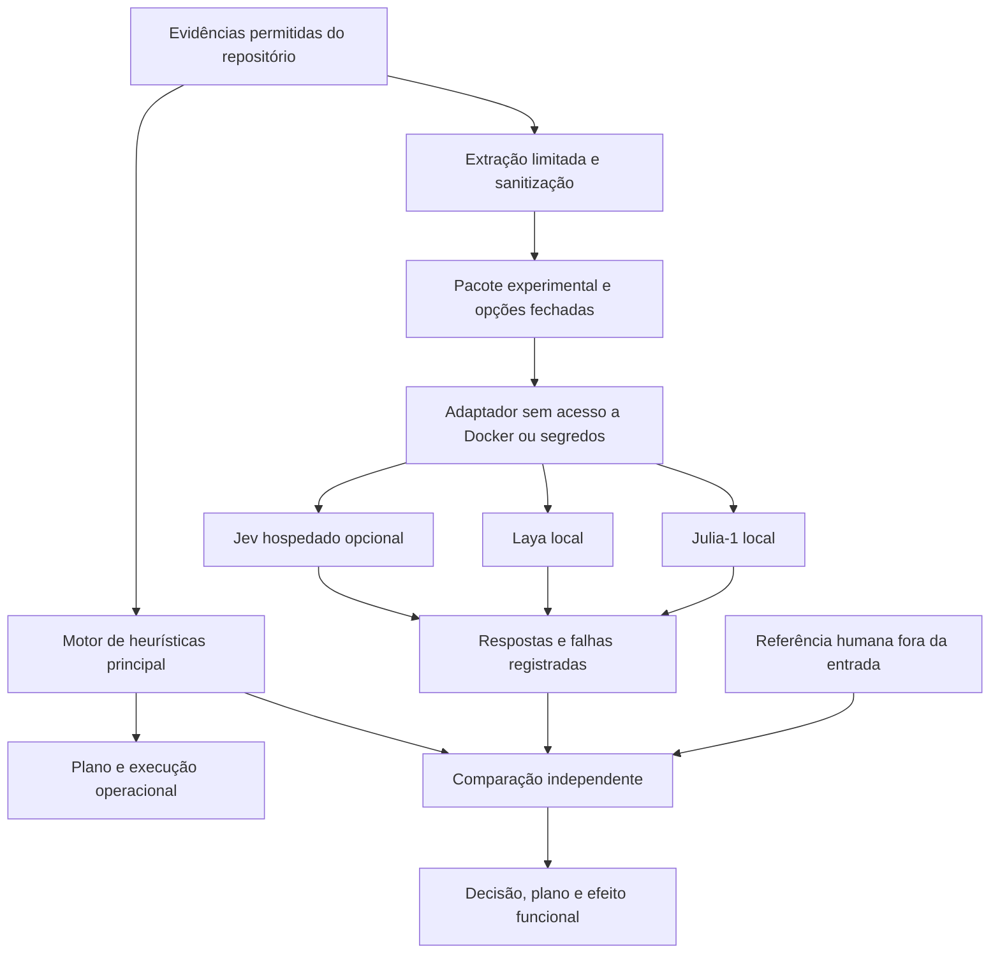

# Cobogó — documento mestre do projeto e do TCC

> Deploy automático guiado por heurísticas.
>
> Autor: Bianco Da Costa Oliveira · Versão 0.4 · 17 de outubro de 2026
>
> **Estado: proposta inicial para revisão.** Este documento especifica o projeto futuro; não descreve funcionalidades já implementadas. Não autoriza apagar a implementação atual nem alterar a infraestrutura do homelab.

## 1. Como usar este documento

Este é o ponto de entrada para produto, requisitos, arquitetura e avaliação acadêmica. As decisões devem continuar pequenas e rastreáveis, para que uma pessoa consiga construir e avaliar o sistema.

| Identificador | Significado |
| --- | --- |
| OBJ | Objetivo verificável do projeto |
| RF | Requisito funcional: o que o sistema faz |
| RNF | Requisito não funcional: qualidade e restrições verificáveis |
| RN | Regra de negócio ou de operação |
| DEC | Decisão de projeto, com motivação, alternativas e consequência |
| HEU | Heurística identificável e versionada |
| TEL | Tela ou visão principal da interface |
| AB | Questão em aberto |

Os requisitos e metas abaixo são **propostos**, salvo indicação de informação confirmada pelo autor. Aprovar este documento estabelece a linha de base; não significa que os requisitos estejam implementados. Ao mudar uma decisão, registrar data, motivo e requisitos afetados. Os diagramas Mermaid dentro deste arquivo são a fonte canônica; as imagens em `diagramas/` são prévias derivadas.

Leitura orientada: [escopo e entregas](#6-recorte-de-escopo-e-entregas), [requisitos funcionais](#9-requisitos-funcionais), [requisitos não funcionais](#10-requisitos-não-funcionais), [arquitetura](#12-arquitetura-proposta), [variáveis e segredos](#171-variáveis-env-e-segredos), [telas e dashboard](#18-experiência-de-uso-telas-e-observabilidade), [avaliação](#19-avaliação-técnica-e-de-produtividade), [experimento com modelos](#194-experimento-com-modelos-de-decisão), [DECs](#20-decisões-de-projeto--decs) e [roadmap](#21-roadmap-e-critérios-de-saída).

Prévias dos diagramas: [contexto](diagramas/01-contexto.svg), [arquitetura](diagramas/02-arquitetura.svg), [modelo de dados](diagramas/03-modelo-de-dados.svg), [pipeline de deploy](diagramas/04-pipeline-deploy.svg), [sequência](diagramas/05-sequencia-deploy.svg), [estados](diagramas/06-estados-deploy.svg), [CI/CD do Cobogó](diagramas/07-pipeline-cobogo.svg), [ciclo dos segredos](diagramas/08-ciclo-segredos.svg) e [experimento de decisão](diagramas/09-experimento-decisao.svg).

A [matriz de referências comentadas](REFERENCIAS-COMENTADAS.md) identifica os dez PDFs fornecidos pelo autor, sua relação com o Cobogó, seções/páginas úteis e limites das evidências.

## 2. Informações confirmadas e ponto de partida

- O projeto é um TCC desenvolvido individualmente.
- O horizonte informado é de aproximadamente 18 meses, com uma entrega mínima até dezembro de 2026. A data formal da defesa ainda precisa ser confirmada; abril de 2028 é apenas uma referência de planejamento.
- O autor pretende usar Go no backend e React no frontend.
- O ambiente de demonstração será o homelab com Proxmox; o autor possui domínio na Cloudflare. Recursos disponíveis, domínio exato e forma de publicação ainda não foram informados.
- O interesse inicial de suporte inclui Python, aplicações JavaScript/Node.js e, possivelmente, Go.
- O autor quer preenchimento guiado das variáveis necessárias, proteção de segredos durante todo o ciclo e acompanhamento geral, por stack e por contêiner na dashboard.
- O motor de heurísticas continua principal. O autor solicitou pesquisar e planejar testes com Jev, Laya e Julia-1; os projetos e o artigo de referência foram confirmados por links fornecidos por ele.
- A implementação local existente usa Node.js/TypeScript, PostgreSQL, Redis/BullMQ e Traefik. O README a apresenta como um protótipo de PaaS para Node.js. Isso é contexto histórico, não obrigação da nova arquitetura.
- O autor considera substituir a implementação atual. A decisão de descarte permanece aberta; preservar o histórico e avaliar aprendizados antes de removê-la.

Fonte conceitual: anotações fornecidas pelo autor, com os blocos “Cobogó — Deploy automático guiado por heurísticas” e “Parte 2: o inimigo agora é o mesmo”. A segunda formulação da pesquisa orienta esta proposta por explicitar produtividade e deploy funcional.

## 3. Visão, problema e público

O Cobogó analisa um repositório, identifica evidências sobre construção e execução, produz um plano explicável, gera um Dockerfile e conduz a aplicação até um ambiente acessível. Quando faltarem informações, deve apontar a lacuna e permitir correção.

O problema investigado é o esforço repetitivo e sujeito a falhas para preparar o caminho entre código e aplicação funcionando: dependências, imagem base, comandos, portas, variáveis e serviços auxiliares. O público principal são estudantes, pessoas desenvolvedoras e equipes pequenas sem dedicação exclusiva a operações.

Há dois perfis relevantes: quem domina o processo e quer reduzir repetição; e quem tem dificuldade em configurar o primeiro deploy. A experiência prévia deve ser registrada na avaliação, sem pressupor que ambos terão o mesmo ganho.

O nome remete ao elemento modular da arquitetura brasileira. A identidade do produto deve transmitir peças compreensíveis que se conectam e permitem o fluxo entre código e execução.

## 4. Pergunta de pesquisa e contribuição

**Pergunta principal proposta:** em aplicações web que seguem os perfis suportados, em que medida um fluxo de deploy guiado por heurísticas reduz tempo e intervenções até o primeiro deploy funcional, em comparação com a configuração manual?

| Questão | Evidência esperada |
| --- | --- |
| QP1 — Em quais casos o deploy funciona sem correções? | Taxa de sucesso autônomo, cobertura de análise e falhas por perfil |
| QP2 — O fluxo reduz tempo e esforço? | Tempo total, tempo ativo, tentativas e intervenções nas duas condições |
| QP3 — Como a pessoa percebe o uso? | Questionário de utilidade, facilidade, confiança e comentários |
| QP4 — Como o sistema se comporta diante de ambiguidade? | Abstenções corretas e decisões automáticas incorretas |

Hipóteses de trabalho, ainda não comprovadas:

- H1: perfis convencionais têm maior sucesso autônomo que projetos com configuração incompleta ou não convencional.
- H2: o Cobogó reduz a mediana do tempo até o primeiro deploy funcional nas tarefas avaliadas.
- H3: o ganho varia com a experiência prévia; o tamanho do estudo pode não permitir concluir diferenças entre grupos.

A contribuição pretendida é um artefato de automação explicável, um catálogo de heurísticas reproduzível e uma avaliação dos limites do fluxo completo. Não se pressupõe ineditismo do conceito de inferir builds; a revisão de trabalhos relacionados deverá situar a contribuição.

A triagem dos PDFs já identifica sobreposição direta: Sampaio, Picoli e Sampaio (2024) combinam interpretação, geração de Dockerfile e deploy; Lyu et al. (2026) apresentam DRAFT para geração/refinamento por LLM. Assim, a contribuição candidata deve ser delimitada pela inferência verificável, configuração guiada, integração dos serviços e avaliação do esforço/resultado, sem afirmar que essa combinação é inédita antes de ampliar a revisão. Ver REF-01 e REF-04 na matriz.

## 5. Objetivos e metas

| ID | Objetivo | Evidência de conclusão |
| --- | --- | --- |
| OBJ-01 | Automatizar o fluxo de um repositório até uma aplicação respondendo | Demonstração repetível no homelab |
| OBJ-02 | Explicar inferências e tratar informação insuficiente | Relatório com regras, evidências, conflitos e entradas solicitadas |
| OBJ-03 | Suportar os perfis Node.js, Python e frontend estático definidos abaixo | Casos de aceitação positivos e negativos por perfil |
| OBJ-04 | Conectar PostgreSQL a uma aplicação mediante declaração explícita | Aplicação gravando e lendo dados após recriação do contêiner |
| OBJ-05 | Medir eficácia técnica e produtividade | Protocolo congelado, dados brutos e análise de resultados |
| OBJ-06 | Manter a solução executável e sustentável por uma pessoa | Instalação documentada, limites operacionais e recuperação demonstrados |
| OBJ-07 | Guiar configuração e uso de segredos sem exposição indevida | Formulário de pendências, vínculos e testes de proteção por etapa |
| OBJ-08 | Tornar o comportamento das aplicações observável em diferentes níveis | Dashboard geral, projeto/stack e contêiner com origem e atualização dos dados |
| OBJ-09 | Investigar o valor adicional de modelos de decisão sobre as heurísticas | Experimento separado com decisões, planos e execução avaliados; não condiciona D0 |

**Metas de pesquisa propostas**, a confirmar após o piloto e antes da avaliação final: pelo menos 80% de sucesso autônomo no conjunto elegível reservado; redução de pelo menos 30% na mediana do tempo em tarefas comparáveis. São critérios de referência para discutir resultados, não promessas nem condições para esconder resultados negativos.

Para dezembro, a meta é demonstrar o fluxo completo com três repositórios pequenos de Node.js, incluindo um caso de falha explicada. Isso comprova a integração inicial; não valida a generalização das heurísticas.

## 6. Recorte de escopo e entregas

### 6.1 Entrega D0 — demonstração mínima até dezembro de 2026

Uma pessoa administradora importa um repositório público GitHub de aplicação HTTP Node.js, acompanha análise e build e recebe uma URL verificável. O perfil exige npm, `package-lock.json`, comando de início e contrato de porta conhecidos. O sistema apresenta o Dockerfile e o motivo das escolhas. Um caso incompleto deve pedir informação ou recusar o perfil claramente.

Backend em Go, interface React enxuta, um worker, PostgreSQL interno, Docker e proxy reverso. Destino: uma VM Linux no Proxmox. Um ou dois hostnames da Cloudflare podem ser preparados manualmente para a demonstração. A instalação do Cobogó e a configuração inicial do domínio são tarefas do operador, fora da automação por repositório.

Não exigir Python, provisionamento de banco auxiliar, compatibilidade ampla, descoberta arbitrária de portas ou estudo com participantes para cumprir D0. Proteger o painel com autenticação antes de disponibilizá-lo externamente; a aplicação demonstrativa pode ter acesso público.

### 6.2 MVP do TCC — após D0

- Perfis Node.js/npm, Python/pip e frontend estático construído com Node.js ou servido diretamente.
- Uma aplicação HTTP principal por projeto, com diretório raiz selecionável; um único ambiente de execução por projeto.
- Variáveis de ambiente, overrides explícitos e histórico de planos e deploys.
- PostgreSQL auxiliar opcional por projeto, rede privada e volume persistente.
- Diagnóstico de falhas, preservação da versão anterior em atualização malsucedida e recuperação após reinício do worker.
- Coleta de métricas e execução dos estudos técnico e de uso.
- Descoberta e preenchimento guiado de variáveis, com importação opcional de `.env` e vínculos de serviços sem copiar credenciais manualmente.
- Dashboard com saúde atual, recursos e histórico por projeto/stack/contêiner, distinta das métricas acadêmicas de eficácia.

A pesquisa de modelos entra em uma trilha experimental própria, após estabilizar a base heurística. Especificar o teste agora não implica tornar um provedor ou runtime de IA obrigatório para usar o Cobogó.

### 6.3 Extensões condicionadas a tempo

Go como aplicação publicada; Django; mais gerenciadores de dependência; Redis auxiliar; webhooks; repositórios privados; deploy de múltiplos serviços; importação limitada de Dockerfile/Compose. Cada inclusão exige perfil, aceitação e atualização do protocolo antes de entrar na avaliação.

### 6.4 Fora do escopo inicial

Kubernetes, múltiplos hosts, escalonamento automático, alta disponibilidade, cobrança, marketplace, execução pública de código arbitrário, isolamento forte entre clientes não confiáveis, configuração automática do Proxmox, provisionamento de nuvem e garantia de zero downtime. Geração livre de comandos/Dockerfiles por LLM e reparo automático de código não fazem parte do motor heurístico. A seleção experimental entre candidatos validados por modelos de decisão é tratada na seção 19.4.

## 7. O que significa suportar uma stack

JavaScript é a linguagem; Node.js é um ambiente de execução. Uma API Node.js e uma SPA React podem usar a mesma linguagem e exigir destinos distintos. TypeScript só entra quando o próprio projeto declara o caminho de compilação; o Cobogó não inventa esse processo.

| Perfil | Sinais e contrato mínimo | Build e execução esperados | Fase |
| --- | --- | --- | --- |
| P-NODE | `package.json`, lockfile npm coerente, `scripts.start`, porta informada ou declarada pelo perfil | Instalação pelo lockfile; build declarado quando necessário; processo HTTP com bind acessível no contêiner | D0 |
| P-PY-ASGI | `requirements.txt`, dependências compatíveis, alvo ASGI único ou informado | Instalação pip; servidor ASGI de produção previsto pelo perfil | MVP |
| P-PY-WSGI | `requirements.txt`, aplicação Flask identificável e alvo WSGI único ou informado | Instalação pip; servidor WSGI de produção previsto pelo perfil | MVP |
| P-STATIC | Entrada estática explícita ou build declarado, diretório de saída conhecido | Build com dependências de desenvolvimento quando necessário; artefatos servidos por servidor HTTP | MVP |
| P-GO | `go.mod`, alvo `main` único ou informado e contrato HTTP | Compilação em estágio separado; binário de execução | Extensão |

Regras de cobertura: Python não significa executar qualquer script; React não implica servidor Node.js em produção; Next.js não equivale a SPA estática. SSR, ferramentas de desenvolvimento como servidor final, Poetry/uv, pnpm/yarn, extensões nativas com pacotes de sistema não previstos e monorepos com orquestração ficam fora até haver um perfil específico.

Versões exatas de runtimes, imagens e ferramentas serão fixadas no catálogo durante a implementação e registradas por deploy. Não reutilizar automaticamente as versões antigas do protótipo. A ausência de lockfile ou pinagem completa deve ser declarada como limite de reprodutibilidade; no piloto, preferir exemplos com dependências fixadas.

## 8. Regras de produto e operação

| ID | Regra |
| --- | --- |
| RN-01 | “Deploy funcional” exige build concluído, contêiner em execução e probe HTTP aprovado; no experimento, exige também o teste funcional definido para o repositório. |
| RN-02 | Informação obrigatória ausente ou sinais conflitantes impedem execução automática do plano. Uma porta padrão nunca é apresentada como porta comprovada. |
| RN-03 | Overrides válidos e explícitos têm precedência; depois vêm declarações suportadas do repositório e, por último, defaults documentados. Restrições de segurança prevalecem sobre configurações. |
| RN-04 | Cada deploy usa um commit imutável e um plano final imutável. A mudança da branch depois da análise exige novo deploy. |
| RN-05 | Driver de banco em dependências é apenas pista. Criar banco exige declaração ou seleção explícita do serviço e do vínculo de configuração. |
| RN-06 | Dados e credenciais do PostgreSQL interno do Cobogó não são compartilhados com aplicações publicadas. |
| RN-07 | Um projeto pode ter no máximo uma operação de deploy efetivamente executando; pedidos repetidos com a mesma chave de idempotência não criam efeitos duplicados. |
| RN-08 | Build, migração ou início não executam no processo da API. A análise estática não executa código do repositório; builds e instalações executam código e usam ambiente controlado. |
| RN-09 | Falhas de configuração não geram tentativas infinitas. Somente falhas transitórias classificadas podem ser repetidas automaticamente, com limite. |
| RN-10 | Remover projeto ou contêiner não implica remover volumes. Exclusão de dados é uma operação separada, explícita e registrada. |
| RN-11 | Logs e exportações passam por ocultação de segredos conhecidos. O sistema não promete detectar todo segredo que uma aplicação imprima. |
| RN-12 | Sucesso histórico do deploy e saúde atual são informações distintas. Uma queda posterior altera a saúde da release, preservando o histórico da execução. |
| RN-13 | Migrações de esquema da aplicação não são inferidas nem executadas por convenção. Exigem comando declarado e política explícita; rollback da imagem não desfaz migrações. |
| RN-14 | Um Dockerfile ou Compose existente é informado ao usuário; D0 não o executa automaticamente nem o sobrescreve no Git. A pessoa deve selecionar um modo suportado ou receber indicação de incompatibilidade. |
| RN-15 | Heurísticas descobrem nomes e necessidades de configuração; não inventam valores secretos. Valores de `.env`, credenciais, tokens e conexões autenticadas não entram no contexto de modelos de decisão. |
| RN-16 | Métricas pertencem ao projeto, recurso e intervalo efetivamente medidos. Novo contêiner/release inicia nova série; ausência de coleta não é consumo zero nem aplicação saudável. |
| RN-17 | Modelo experimental só pode sugerir opções previamente permitidas. Nunca autoriza permissões, cria comandos, altera segredos, remove dados ou substitui validações determinísticas. |
| RN-18 | A interface descreve o alcance real da criptografia. Criptografia em trânsito e em repouso não é anunciada como servidor incapaz de acessar segredos. |

## 9. Requisitos funcionais

Fase D0 = necessário na demonstração; MVP = necessário na entrega completa; EXT = extensão; EXP = trilha experimental planejada, sem dependência operacional. “Verificação” descreve aceitação futura, não teste já realizado.

| ID | Requisito | Fase | Verificação de aceitação |
| --- | --- | --- | --- |
| RF-01 | Registrar projeto com URL Git, referência e diretório raiz | D0 | Aceitar URL pública GitHub permitida e rejeitar protocolos/caminhos indevidos |
| RF-02 | Resolver referência para SHA e analisar arquivos sem executar o projeto | D0 | Registrar SHA, perfil candidato, evidências e resultado em exemplo válido e ambíguo |
| RF-03 | Produzir plano inspecionável com runtime, comandos, porta, etapas e pendências | D0 | Cada campo mostra origem: regra, declaração, default ou override |
| RF-04 | Gerar e disponibilizar Dockerfile e política de contexto de build | D0 | Arquivo corresponde ao plano e repositório original permanece intacto |
| RF-05 | Executar deploy assíncrono, persistindo estado e eventos | D0 | Requisição retorna ID sem esperar build e interface acompanha andamento |
| RF-06 | Iniciar aplicação, verificar readiness e retornar URL roteada | D0 | Probe por rota real funciona; falha de probe não aparece como sucesso |
| RF-07 | Exibir logs por etapa e erro acionável | D0 | Usuário identifica etapa, causa conhecida e próxima ação sem acessar terminal do worker |
| RF-08 | Solicitar entrada quando faltar dado e permitir corrigir plano | D0 | Exemplo sem porta/alvo gera pendência; correção revalida o mesmo SHA |
| RF-09 | Autenticar pessoa administradora e proteger operações e logs | D0 | Chamadas sem sessão válida não alteram projetos nem leem logs |
| RF-10 | Gerenciar variáveis e segredos de execução | MVP | Valores ocultos na leitura; app recebe valor; exportação e logs não revelam segredo de teste |
| RF-11 | Implementar perfis Python e estático definidos na seção 7 | MVP | Casos positivos e negativos para cada perfil passam pelos mesmos contratos |
| RF-12 | Provisionar PostgreSQL auxiliar explicitamente solicitado | MVP | Credencial exclusiva, volume e rede do projeto; banco sem porta pública |
| RF-13 | Vincular variáveis ao serviço auxiliar com mapeamento explícito | MVP | Aplicação usa o vínculo escolhido, sem sobrescrever valor do usuário silenciosamente |
| RF-14 | Parar, reiniciar e remover recursos de aplicação com rastreabilidade | MVP | Operação é registrada e não remove volume de banco |
| RF-15 | Atualizar aplicação preservando release anterior até validar a candidata | MVP | Candidata inválida mantém rota anterior; sucesso atualiza release ativa |
| RF-16 | Reconciliar jobs e recursos após reinício/interrupção | MVP | Reinício durante build/início não duplica banco, volume ou release ativa |
| RF-17 | Registrar e exportar métricas de avaliação sem segredos | MVP | Exportação inclui tempos, perfil, regras, tentativas, resultado e intervenções |
| RF-18 | Aplicar retenção e limpeza apenas a recursos geridos pelo Cobogó | MVP | Limpeza não toca recursos alheios, release ativa, anterior protegida ou volumes |
| RF-19 | Receber webhook autenticado e iniciar deploy de commit permitido | EXT | Evento duplicado não dispara operação duplicada |
| RF-20 | Publicar aplicações Go conforme perfil específico | EXT | Alvo único e ambiguidade de múltiplos alvos tratados explicitamente |
| RF-21 | Descobrir nomes de variáveis e apresentar pendências com evidências | MVP | `.env.example` e declarações suportadas geram campos; casos ambíguos não viram obrigatoriedade silenciosa |
| RF-22 | Importar `.env` por ação explícita, com revisão e classificação por campo | MVP | Parser não executa conteúdo, aponta duplicatas e não salva/enfileira arquivo bruto |
| RF-23 | Versionar configuração, trocar segredo e indicar necessidade de novo deploy | MVP | Alteração não muda silenciosamente release em execução; versão anterior permanece referenciada |
| RF-24 | Exibir saúde e recursos por contêiner gerido | MVP | CPU, memória, reinícios, identidade e horário da amostra correspondem ao recurso selecionado |
| RF-25 | Agregar observação por projeto, stack operacional e perfil tecnológico | MVP | Navegar do geral ao contêiner mantendo filtros e sem duplicar recursos compartilhados |
| RF-26 | Consultar histórico de métricas e indicar dados ausentes ou antigos | MVP | Recriação, falha de coleta e período sem amostra aparecem como lacunas identificadas |
| RF-27 | Registrar sugestões de modelos em modo observação, sem efeito no deploy | EXP | Sugestão divergente, timeout e erro não alteram o plano produzido pelas heurísticas |
| RF-28 | Comparar heurísticas e combinação com modelo em ambiente experimental | EXP | Mesmo corpus e contratos; escolhas, efeitos no plano e oráculo funcional são avaliados separadamente |
| RF-29 | Auditar operações sobre segredos sem registrar valores | MVP | Histórico identifica ator, projeto, ação e versão; segredo de teste não aparece no evento |

## 10. Requisitos não funcionais

Os valores numéricos são parâmetros iniciais propostos. Validá-los no piloto e congelar a configuração antes de medir o conjunto final. Hardware do homelab ainda não foi inventariado.

| ID | Requisito e critério verificável | Fase |
| --- | --- | --- |
| RNF-01 | Na base heurística, mesmos arquivos, configurações e versões de regras/templates produzem o mesmo plano normalizado; timestamps e IDs não entram na comparação. Variação de modelos é registrada separadamente no experimento | D0 |
| RNF-02 | 100% dos campos decisórios do plano têm origem rastreável; cada bloqueio informa dado faltante ou conflito | D0 |
| RNF-03 | Somente componentes operacionais autorizados acessam a API Docker; API pública e aplicações não recebem socket, modo privilegiado ou montagens arbitrárias do host | D0 |
| RNF-04 | Repositórios de D0 são previamente selecionados; clone com timeout e limite de tamanho; apenas HTTPS em host permitido, sem submódulos/LFS automáticos ou destinos privados por redirecionamento | D0 |
| RNF-05 | Aplicar limites de CPU, memória, duração e logs; ponto inicial: um build simultâneo, timeout de build de 10 min e readiness de 120 s. Limites efetivos do builder devem ser comprovados | D0 |
| RNF-06 | Operações comuns de API devem ter p95 até 500 ms no piloto com cinco projetos, excluídos clone/build/streaming; publicar hardware, carga e método usados | MVP |
| RNF-07 | Jobs usam persistência e lease; após expiração, reconciliar em até dois ciclos do worker. Proposta: lease de 60 s com heartbeat de 15 s | MVP |
| RNF-08 | Segredos são cifrados em repouso com chave fora do banco; sessões usam proteção apropriada e cookies restritos ao hostname de gestão; verificar ausência do segredo de teste nos artefatos | MVP |
| RNF-09 | Todo deploy tem correlação entre SHA, plano, eventos, logs, imagem e release; tempos usam UTC e durações usam relógio adequado | D0 |
| RNF-10 | Fluxo principal funciona por teclado, apresenta foco e rótulos e comunica estado sem depender apenas de cor | MVP |
| RNF-11 | Instalação e recuperação em VM Linux limpa são documentadas; restauração do banco interno e de um volume auxiliar é demonstrada antes da avaliação | MVP |
| RNF-12 | Regras e templates são testáveis sem Docker; testes com Docker cobrem build, readiness, persistência, falha e retomada. Mudança de perfil exige caso positivo e caso de abstenção | MVP |
| RNF-13 | Proposta de coleta a cada 15 s e histórico bruto de 24 h; marcar como antiga uma série sem atualização por 30 s e registrar lacunas. Congelar parâmetros após medir custo no homelab | MVP |
| RNF-14 | Usar cifragem autenticada e chaves versionadas fora do banco; adulteração do ciphertext e tentativa de usar segredo de outro projeto devem falhar. Provar restauração e troca de chave antes da avaliação | MVP |
| RNF-15 | O adaptador experimental recebe apenas contexto permitido e sanitizado; testes com segredo-canário e conteúdo adversarial não podem produzir saída de segredo nem efeito operacional | EXP |
| RNF-16 | Medir sobrecarga de coleta e inferência separadamente de build/runtime; limitar duração, concorrência, memória e retenção. Indisponibilidade experimental não bloqueia a base heurística | MVP/EXP |

## 11. Motor de heurísticas

O aprofundamento do contrato de evidências, das regras e do pipeline está em [Motor de heurísticas e apoio por modelos de decisão](MOTOR-DE-HEURISTICAS.md). O [roteiro de pesquisa](pesquisa/HEURISTICAS-REFERENCIAS.md) reúne artigos sobre regras, abstenção, calibração e interação, além de mecanismos de detecção e vínculo de serviços. Esses documentos complementam este mestre; não representam funcionalidades implementadas.

### 11.1 Contrato de análise

Entrada: árvore de arquivos limitada ao diretório escolhido, SHA, metadados permitidos e configurações explícitas. Saída: candidatos de perfil, evidências, plano, campos pendentes, conflitos, regras disparadas e suas versões. Conteúdo de arquivo é dado, não instrução para a plataforma.

Um plano inclui: perfil e runtime; imagem base; gerenciador de dependências; comandos de instalação/build/início; diretório de saída, quando houver; porta e bind; probe; referências a variáveis e serviços; limites; versão do gerador. Valores secretos não integram o plano exportável.

Resultado da análise:

- **Pronto:** todos os campos obrigatórios têm uma origem permitida e não há conflito bloqueante. Pode prosseguir conforme a solicitação de deploy já feita.
- **Precisa de informação:** há um perfil possível, mas faltam campos ou há alternativas. Solicitar apenas os dados necessários.
- **Não suportado:** o projeto exige um perfil/capacidade ausente. Informar o limite sem tentar um template genérico silenciosamente.

Não apresentar “90% de confiança” sem calibração. Usar evidência explícita, inferência por convenção e informação insuficiente como categorias explicativas. Uma dependência isolada pode sugerir framework; não comprova entrypoint, porta nem necessidade de banco.

### 11.2 Catálogo inicial

| ID | Evidência e decisão | Limite ou abstenção |
| --- | --- | --- |
| HEU-01 | `package.json` e lockfile npm coerentes permitem candidato P-NODE ou P-STATIC | Workspaces/múltiplos locks ou runtime alternativo exigem perfil específico |
| HEU-02 | `scripts.start` declara comando de execução em P-NODE | Ausência não autoriza escolher `index.js` arbitrariamente; script de desenvolvimento não é aceito como produção |
| HEU-03 | Build e diretório de saída declarados permitem P-STATIC | Presença de React não determina saída estática; SSR não é tratado como SPA |
| HEU-04 | `requirements.txt` com framework e alvo ASGI/WSGI inequívoco permite perfil Python correspondente | Múltiplos alvos ou dependências de sistema não previstas bloqueiam |
| HEU-05 | Contrato explícito de `PORT` e bind, ou configuração suportada, determina porta interna | Constante encontrada em código é apenas pista; default deve ser mostrado e validado |
| HEU-06 | Declaração de PostgreSQL e vínculo explícito criam plano de serviço auxiliar | Driver ou `DATABASE_URL` isolados não autorizam provisionamento |
| HEU-07 | `go.mod` e alvo principal único permitem candidato P-GO | Não executar até o perfil opcional ser implementado; CGO exige tratamento próprio |
| HEU-08 | Dockerfile/Compose existente gera aviso e escolha de modo | Não executar configuração arbitrária nem substituir arquivo original automaticamente |
| HEU-09 | Nomes em `.env.example`, schema explícito e acessos estáticos suportados sugerem configuração necessária | Obrigatoriedade/tipo dependem de declaração ou revisão; não copiar valores, expandir variáveis ou executar imports para descobrir campos |

Cada regra deve ter ID, versão, pré-condições, evidências utilizadas, campos produzidos, conflitos e exemplos positivos/negativos. Evitar um bloco crescente de exceções por nome de repositório.

### 11.3 Qualidade dos Dockerfiles gerados

Propor templates por perfil com imagem de origem confiável, usuário sem privilégios quando compatível, etapas separadas de build/runtime quando úteis, dependências necessárias ao build disponíveis no estágio correto e exclusão de `.git`, segredos e arquivos dispensáveis do contexto. O contexto gerado precisa respeitar as regras do projeto e aplicar exclusões obrigatórias da plataforma, sem enviar credenciais por acidente.

Registrar digest da imagem base e ID/digest da imagem produzida. Tags mutáveis e dependências não fixadas limitam a repetibilidade; não prometer imagens idênticas somente porque o Dockerfile é igual. Essas escolhas seguem as [boas práticas oficiais de build do Docker](https://docs.docker.com/build/building/best-practices/).

Segredos de runtime são injetados na execução. D0 não oferece segredos de build; se essa capacidade for adicionada, usar um canal próprio do builder, sem persistir valores em `ARG`, `ENV` ou camadas. Ver [Build secrets](https://docs.docker.com/build/building/secrets/).

## 12. Arquitetura proposta

Um **monólito modular em Go**, com API e worker como processos separados e código de domínio compartilhado. Essa separação impede que um build bloqueie requisições, sem exigir microserviços. React fornece a interface; uma SPA é suficiente para o painel inicialmente.

| Módulo | Responsabilidade |
| --- | --- |
| API e acesso | Sessão, validação de entradas, projetos, configurações e consultas |
| Aquisição Git | Obter somente fonte permitida, resolver SHA e controlar workspace temporário |
| Analisador | Ler sinais e produzir evidências, candidatos e pendências |
| Planejador/gerador | Resolver precedências e gerar plano e arquivos de build |
| Worker/orquestrador | Conduzir estados, limites, efeitos e recuperação |
| Adaptador Docker | Build, redes, contêineres, volumes e inspeção |
| Roteamento | Publicar apenas releases autorizadas e verificar rota |
| Persistência/telemetria | Metadados, jobs, eventos, artefatos e métricas |
| Configuração e segredos | Descoberta de campos, cifragem, vínculos de serviços e entrega restrita ao executor |
| Coletor operacional | Amostras e eventos dos recursos geridos, com acesso restrito de leitura e orçamento de coleta |
| Adaptador experimental | Contexto sanitizado, chamadas opcionais de modelos e registro de resultados; sem acesso a Docker ou chaves de segredos |

Go é uma escolha coerente com a intenção do autor e possui SDK oficial para o Docker Engine. Isso facilita a integração, mas não torna Go obrigatório nem garante segurança ou desempenho por si só. Framework HTTP e biblioteca de acesso a dados serão escolhidos na implementação; começar pela necessidade, sem comprometer o projeto agora com um framework. Referência: [Docker Engine SDKs](https://docs.docker.com/reference/api/engine/sdk/).

### 12.1 Contexto do sistema



### 12.2 Componentes e fronteiras



O diagrama inclui capacidades do MVP completo. D0 pode omitir o banco auxiliar; a descoberta do proxy deve respeitar RNF-03. O armazenamento local é suficiente no servidor único: banco guarda metadados e caminhos opacos, não um fluxo ilimitado de logs.

### 12.3 Fila e concorrência

Proposta inicial: jobs no próprio PostgreSQL, um worker e um build simultâneo. Criar deploy e job na mesma transação evita perder trabalho entre banco e fila. PostgreSQL documenta `SKIP LOCKED` para consumidores de tabelas semelhantes a filas; isso é uma base, não uma solução completa de jobs. Ver [SELECT — locking clauses](https://www.postgresql.org/docs/current/sql-select.html).

Reivindicar o job em transação curta, persistir lease e liberar o lock antes do build. Heartbeat mantém a posse; retomadas verificam recursos por identificadores estáveis. Um worker que perdeu o lease não pode publicar resultado: usar verificação de posse/geração e serialização por projeto antes de efeitos críticos. Não prometer execução “exatamente uma vez”; projetar retomadas e efeitos idempotentes.

Redis fica adiado. Reavaliar quando volume, latência ou complexidade da fila justificar outra infraestrutura. O protótipo ter BullMQ não obriga reproduzir essa escolha em Go.

## 13. Homelab, rede e publicação

**Proposta:** uma VM Linux dedicada no Proxmox, com Docker, serviços do Cobogó e workloads selecionados. A documentação do Proxmox recomenda VM QEMU para cenários de Docker/orquestração e desaconselha Docker diretamente no host Proxmox. Referência: [FAQ oficial do Proxmox](https://github.com/proxmox/pve-docs/blob/master/pve-faq.adoc).

Configuração inicial de planejamento: 4 vCPU, 8 GiB RAM e disco com folga para imagens. Esses valores não foram confirmados como disponíveis nem representam capacidade medida. Inventariar antes de fixar limites. Um único host implica interrupção durante falha da VM, do homelab ou da conectividade.

| Camada | Proposta | Observação |
| --- | --- | --- |
| Virtualização | VM Linux dedicada | Backup e restauração administrados no homelab |
| Entrada externa | Cloudflare Tunnel até o Traefik | Alternativa: DNS e entrada HTTPS direta; decidir após conhecer a rede |
| Proxy | Traefik com exposição explícita | Apenas aplicações selecionadas; painel administrativo protegido |
| Rede de controle | API, worker e PostgreSQL interno | Não publicar PostgreSQL nem Docker na Internet |
| Rede por projeto | Aplicação e seu serviço auxiliar | Banco auxiliar sem porta do host; app pode participar também da rede de entrada |
| Persistência | Volumes distintos para core, artefatos e bancos de aplicações | Limpeza de imagens não remove volumes |

O Tunnel estabelece conexões de saída; possuir domínio na Cloudflare não significa que Tunnel já exista. É preciso configurar DNS, rota do túnel, hostname e destino no proxy. Referências: [routing](https://developers.cloudflare.com/tunnel/concepts/routing/) e [configuração de ingress](https://developers.cloudflare.com/tunnel/features/locally-managed-tunnels/configuration-file/).

Para começar, usar nomes ilustrativos de um nível: `cobogo.seudominio.tld` e `app-demo.seudominio.tld`. Reservar nomes da gestão e impedir que slugs de projetos os reutilizem. Só depois automatizar hostnames/wildcard. Em configuração completa de zona, Universal SSL cobre o domínio e o primeiro nível de subdomínios; não assumir cobertura de `app.apps.seudominio.tld`. Conferir certificado e modo de configuração da zona. Referência: [limitações de Universal SSL](https://developers.cloudflare.com/ssl/edge-certificates/universal-ssl/limitations/).

Manter hostname original no encaminhamento ao Traefik e aceitar cabeçalhos de proxy apenas de origens confiáveis. Não colocar credenciais Cloudflare em aplicações ou imagens. D0 pode operar com DNS/túnel configurados pelo autor; integração com a API Cloudflare não é requisito da automação de deploy.

## 14. Bancos, persistência e modelo de dados

### 14.1 Dois papéis distintos

**Banco do Cobogó:** PostgreSQL para projetos, planos, deploys, eventos, jobs e configuração. Migrações versionadas desde a primeira implementação; chaves, índices e transações para integridade. Evidências e planos podem usar JSONB, preservando colunas relacionais para identidade e estado.

**Banco da aplicação:** uma instância PostgreSQL isolada por projeto no MVP, com credencial própria e volume nomeado. É simples de entender e limpar, mas consome mais memória que bancos separados em uma mesma instância. Número máximo de projetos depende da medição do homelab. MySQL, MongoDB e Redis não são necessários para comprovar a proposta inicial.

### 14.2 Modelo lógico inicial

| Entidade | Conteúdo principal |
| --- | --- |
| users | Administrador e dados de autenticação; sem cadastro público em D0 |
| projects | Dono, slug, URL, referência, diretório raiz e configuração atual versionada |
| analyses | SHA, versão de configuração/regras, evidências, pendências e plano; snapshots imutáveis |
| deployments | Projeto, SHA, análise/plano final, estado da execução, resultado, tempos e chave de idempotência |
| jobs | Deploy, estado de processamento, lease, geração de posse, tentativas e próximo processamento |
| deployment_events | Deploy, sequência, etapa, tipo, instante e payload sem segredos |
| releases | Deploy de origem, imagem imutável, contêiner, rota, estado operacional e saúde atual |
| services | Projeto, tipo, contêiner, rede, volume, estado e referências a credenciais |
| env_variables | Projeto, nome, versão, escopo/classificação, ciphertext com nonce/tag e versão de chave, ou referência a vínculo; valores não secretos identificados explicitamente |
| artifacts | Deploy, tipo, caminho interno, tamanho, hash e expiração; logs e arquivos gerados |
| metric_samples | Projeto, identidade de release/serviço e contêiner, instante de coleta, métrica, unidade, valor e qualidade da amostra; retenção limitada |
| decision_evaluations | Análise, experimento, modelo/revisão/runtime, pergunta/opções, hash do contexto sanitizado, resposta, escores, duração, erro e referência humana; sem segredos |

Um deploy pode apontar para a análise mais recente enquanto aguarda informação; depois que começa a execução, seu plano final não muda. Correção posterior ao início do build cria novo deploy. A configuração utilizada e versões de segredos/vínculos são registradas por referência versionada, sem exportar valores. Releases distinguem a candidata, a ativa e a anterior protegida.

Restrições mínimas: slug global único no host; nome de variável único por projeto em cada versão de configuração; evento único por deploy/sequência; job ativo único por deploy; no máximo um deploy em execução e uma release ativa por projeto; chave de idempotência única por projeto. FKs compostas ou validação transacional impedem associar análise/release de outro projeto. Registros com efeitos externos são reconciliados antes de remoção definitiva.



Este é um DER lógico simplificado, não um schema SQL definitivo. Campos operacionais, nulabilidade e índices serão detalhados antes de implementar cada módulo. `analysisId` pode estar ausente antes da análise, mas é obrigatório para executar um plano.

### 14.3 Retenção e recuperação

Proposta inicial: reter logs operacionais por 14 dias, proteger release ativa e última anterior e limitar logs por execução. Arquivar os artefatos e dados da pesquisa durante a avaliação, independentemente da retenção operacional. Nunca limpar imagens alheias nem usar prune global como rotina.

Backup do PostgreSQL interno, chave de cifragem guardada separadamente e backup dos volumes auxiliares precisam de procedimento de restauração. Snapshot da VM sozinho não demonstra consistência do banco; validar restauração e leitura. RPO/RTO e frequência definitiva dependem do uso e do espaço disponível.

## 15. Pipeline de deploy das aplicações

1. Validar pedido, acesso, URL e limites; criar deploy/job de forma atômica.
2. Obter fonte em workspace temporário e fixar SHA.
3. Analisar arquivos e persistir evidências e plano candidato.
4. Se faltar dado, aguardar entrada sem manter worker/lock ocupado. Se incompatível, encerrar como não suportado.
5. Finalizar snapshot do plano e gerar Dockerfile/contexto.
6. Construir imagem com limites, logs e identificação imutável.
7. Preparar rede, variáveis e serviços explicitamente solicitados, reutilizando os recursos do projeto quando existentes.
8. Iniciar release candidata; executar probes internos. Em MVP, manter release ativa anterior durante essa validação.
9. Trocar rota sob exclusão por projeto, verificar acesso pela rota e concluir; em falha, restaurar a rota anterior quando houver.
10. Registrar resultado, métricas e limpar somente temporários elegíveis.

Buildar, iniciar e responder são verificações distintas. Probe inicial proposto: caminho HTTP configurável, código esperado e três respostas válidas consecutivas dentro de 120 s. Um `200` genérico não comprova todas as funções do software: cada repositório avaliado tem também um oráculo funcional, por exemplo gravação e leitura no banco.



O diagrama mostra as bifurcações principais; qualquer etapa pode falhar e deve registrar sua causa. Falhas de domínio, DNS ou túnel não devem ser confundidas com falha de inferência.

### 15.1 Interações principais



### 15.2 Estados de uma execução de deploy



`VERIFYING` inclui readiness e verificação da rota antes de concluir. `NEEDS_INPUT` não ocupa worker nem é contado como sucesso autônomo. No primeiro recorte, cancelamento pelo usuário só existe antes da execução ou durante espera por informação; interrupção em etapa ativa segue timeout/recuperação. Tentativas transitórias são registradas no job, sem apagar eventos. Falha terminal exige novo deploy para nova execução solicitada pelo usuário.

## 16. Pipeline do próprio Cobogó

O pipeline das aplicações é a função do produto. O CI/CD do Cobogó é outro fluxo e deve ter credenciais, métricas e responsabilidades separados.

- Em PR: formatação e análise de Go/TypeScript, testes das regras, testes de contratos, build do frontend/backend e validação de documentação/diagramas.
- Em ambiente de integração controlado: casos ponta a ponta com Docker, readiness, banco persistente e recuperação. Código de forks não recebe credenciais do homelab nem roda em runner com acesso a ele.
- Em release: gerar imagens versionadas, registrar digests e publicar em registry escolhido; GHCR é candidato, não configuração existente.
- Atualização do homelab inicialmente manual, com backup, migrações e smoke test. Rollback da plataforma exige avaliar compatibilidade das migrações, além de trocar imagem.

```mermaid
flowchart LR
    change["Pull request"] --> checks["Análise e testes rápidos"]
    checks --> buildArtifacts["Build Go e React"]
    buildArtifacts --> integration["Integração com Docker em ambiente controlado"]
    integration --> review["Revisão e merge"]
    review --> release["Release e imagens imutáveis"]
    release --> update["Atualização manual no homelab"]
    update --> smoke["Smoke test e verificação de migrações"]
```



Não há workflow implementado por este documento. Escolher ferramentas e versões somente ao iniciar essa etapa.

## 17. Segurança e limites do ambiente experimental

Executar dependências ou builds pode executar código do repositório. Por isso, o MVP é uma ferramenta auto-hospedada para operador confiável e corpus selecionado, sem cadastro público de usuários desconhecidos. Docker sozinho não oferece a garantia necessária para hospedar código hostil de terceiros.

O worker é componente privilegiado: a API e as aplicações não recebem o socket. A descoberta do Traefik deve ter acesso filtrado; montar `docker.sock` como somente leitura não transforma a API em somente leitura. Essas restrições derivam do poder da API Docker e do alerta do provedor do Traefik. Referências: [segurança do Docker Engine](https://docs.docker.com/engine/security/) e [acesso Docker no Traefik](https://doc.traefik.io/traefik/reference/install-configuration/providers/docker/).

Separar rede de controle e redes de aplicações; bloquear acesso dos workloads à rede administrativa do homelab, endpoints de gestão e serviços internos. Rede bridge isolada não equivale a uma política de egress: demonstrar a restrição antes de aceitar repositórios externos ao corpus. Não montar diretórios do host escolhidos pelo repositório, expor Docker em TCP sem proteção ou habilitar painel administrativo do proxy publicamente.

Autenticação de um administrador é suficiente para D0; contas adicionais e autorização por proprietário podem crescer depois. Credenciais de túnel e chaves ficam no plano de controle. A redução do escopo de usuários não dispensa validação de URLs, arquivos, caminhos, comandos, quotas e autorização das operações.

### 17.1 Variáveis, `.env` e segredos

**Objetivo:** descobrir necessidades de configuração, conduzir o usuário a preencher apenas o necessário e proteger os valores durante todo o ciclo. `.env` é um formato possível de entrada; não deve se tornar o mecanismo interno de persistência de um arquivo em texto puro.

**Alcance da criptografia:** a proposta inicial usa HTTPS nos trechos de rede, armazenamento cifrado e acesso mínimo durante a entrega ao executor. Isso não é E2EE com servidor sem acesso: a API recebe o valor e o worker/aplicação precisam utilizá-lo. Na publicação via proxy Cloudflare, há terminação de TLS na borda e outra conexão até a origem; Cloudflare também integra a fronteira de confiança. Ver [modos de criptografia da Cloudflare](https://developers.cloudflare.com/ssl/origin-configuration/ssl-modes/).

Se o requisito for impedir que API ou intermediários leiam os valores, será necessário avaliar cifragem no navegador para o executor, autenticação/distribuição de chaves e recuperação. Isso ainda está em aberto, não foi prometido como capacidade existente e não impediria o administrador do executor de acessar o processo que usa o segredo. Nunca anunciar “impossível vazar”.

#### Descoberta e preenchimento guiado

1. Ler nomes e declarações em `.env.example`, schemas de configuração suportados e usos estáticos reconhecidos. Mostrar arquivo/trecho de origem sanitizado; não executar código nem importar valores reais automaticamente.
2. Construir um inventário: nome, descrição, origem da evidência, obrigatoriedade conhecida ou a confirmar, tipo declarado, serviço consumidor e escopo.
3. Classificar a origem do valor: fornecido pelo usuário, gerado pelo Cobogó, vinculado a serviço ou default não secreto explicitamente permitido. Classificar exposição separadamente: segredo de runtime, configuração de runtime ou configuração pública de build.
4. Solicitar somente valores pendentes. Uma referência `process.env.X` sozinha não prova que X é obrigatório; preservar “a confirmar”. Referências dinâmicas ou schemas não suportados exigem informação explícita, não a declaração de descoberta completa.
5. Para PostgreSQL selecionado, oferecer vínculo de `DATABASE_URL` ao serviço. Gerar credencial de forma segura e resolver o vínculo no executor, sem expor senha na interface nem no plano.
6. Bloquear início com campos comprovadamente obrigatórios ausentes. Não exigir variáveis que pertencem apenas ao desenvolvimento quando o perfil consegue distingui-las.

Exemplo ilustrativo de formulário, sem valores reais:

| Variável | Necessidade e origem | Como resolver | Estado exibido |
| --- | --- | --- | --- |
| `DATABASE_URL` | Obrigatória no schema suportado | Vincular ao PostgreSQL do projeto | Vínculo pronto; credencial oculta |
| `JWT_SECRET` | Obrigatória no schema suportado | Informar ou gerar valor criptograficamente aleatório, quando o contrato permitir | Preenchimento necessário |
| `PORT` | Contrato do perfil HTTP | Valor gerido pelo plano | Configurada pelo Cobogó |
| `LOG_LEVEL` | Opcional com default declarado | Manter default ou substituir | Default informado |
| `VITE_API_URL` | Configuração pública do frontend | Informar endereço público sem credenciais | Será incluída no build |

Configuração pública de build não é segredo. Em Vite, variáveis expostas ao cliente são incorporadas ao bundle; cifrá-las no banco não as protege depois da publicação. Bloquear atribuição de segredo a campo identificado como público e mostrar o destino da variável antes de salvar. A detecção depende do perfil e de sua configuração de exposição, não apenas de uma lista de prefixos. Referência: [Vite — variáveis de ambiente](https://vite.dev/guide/env-and-mode).

#### Política de importação de `.env`

Importação é opcional e explícita. Preferir parser no navegador, mostrando nomes e campos mascarados antes do envio. Não salvar o arquivo bruto nem valores em localStorage, telemetria, URL, estado compartilhável ou gravações de sessão. Parser não usa `source`, `eval` ou shell; expansão de referências e comandos é recusada inicialmente. Duplicatas, multiline e sintaxes não suportadas recebem diagnóstico, sem aceitar resultados parciais silenciosamente.

Um `.env` encontrado no Git não é importado por conveniência: avisar sobre possível exposição e excluir o arquivo do contexto gerado de build. `.env.example` também não é presumido livre de segredos; extrair só metadados necessários. A ferramenta não limpa histórico nem revoga credenciais automaticamente. Nenhum arquivo real de segredos entra em contexto de modelo ou exportação acadêmica.

#### Persistência e entrega propostas

| Etapa | Proteção e limite |
| --- | --- |
| Navegador → API | HTTPS, sessão autorizada, corpo fora de logs e caches; campos mascarados sem pré-preencher valor recuperado |
| Persistência | Cifragem autenticada por valor com chave versionada fora do banco; associar projeto, variável e versão ao contexto autenticado |
| Fila/plano/eventos | Somente identificadores de segredo, versão e vínculo; nunca valor em payload de job |
| Executor | Acesso ao subconjunto necessário para o deploy; descriptografia tardia e sem arquivos temporários persistentes |
| Aplicação | Preferir arquivo montado de forma restrita em memória quando o perfil permitir; usar variável de runtime por compatibilidade com risco documentado |
| Logs e observação | Não coletar corpo de configuração/inspeção Docker; redigir segredos conhecidos antes da persistência, inclusive entre fragmentos do stream |
| Backup/restauração | Banco contém ciphertext; chave tem cópia protegida separada e procedimento de recuperação testado |

Como candidato de implementação, usar biblioteca mantida com AEAD, como AES-256-GCM, nonce único por chave e geração aleatória segura. Guardar ciphertext, nonce/tag, versão da chave e metadados; não criar algoritmo próprio. A escolha definitiva e o mecanismo de rotação devem ser revisados antes de implementar. Base: [OWASP — armazenamento criptográfico](https://cheatsheetseries.owasp.org/cheatsheets/Cryptographic_Storage_Cheat_Sheet.html).

Injeção por variável de ambiente mantém o valor acessível ao processo e, em configurações Docker usuais, a quem pode inspecionar o contêiner. Arquivo em memória reduz algumas exposições, mas também depende de permissões do host. A gestão deve incluir ciclo de vida, autorização e auditoria, além da cifra. Referência: [OWASP — gestão de segredos](https://cheatsheetseries.owasp.org/cheatsheets/Secrets_Management_Cheat_Sheet.html).

#### Alteração, rotação e critérios de aceitação

Na interface, preferir “substituir valor” a permitir revelar qualquer segredo salvo. Registrar ator, variável, versão e instante, sem o conteúdo. Mudança de configuração cria versão pendente de aplicação e indica “novo deploy necessário”; a release atual mantém seu snapshot.

Trocar chave de cifragem é diferente de trocar a credencial do PostgreSQL. Rotação de credencial exige alterar o serviço e seus consumidores coordenadamente; editar `DATABASE_URL` não basta. Distinguir esses fluxos e permitir rotação manual documentada no MVP. Exclusão ou revogação de segredo referenciado deve informar as releases afetadas; rollback não restaura uma credencial já revogada por terceiros.

Aceitação futura: usar segredos-canário fictícios para verificar banco, logs, jobs, imagens, artefatos, exportações e respostas de leitura; testar ciphertext adulterado, vínculo entre projetos, nonce/versão, falha de chave e restauração. Testar também `VITE_` público recebendo segredo por engano, importação duplicada e alteração com release em execução. Ocultação não garante reconhecer valores codificados ou segredos novos impressos arbitrariamente pela aplicação.

Em D0, o formulário pode apenas explicar/bloquear necessidades não atendidas usando exemplos sem segredos. Se aceitar valores secretos já nessa fase, RF-10, RNF-08 e as proteções desta seção tornam-se pré-requisitos da funcionalidade, mesmo com gestão completa planejada para o MVP.



## 18. Experiência de uso, telas e observabilidade

Fluxo principal: **importar → entender o plano → preencher/vincular o necessário → acompanhar deploy → observar a aplicação**. Um plano completo pode seguir a partir do pedido de deploy, sem confirmação intermediária repetitiva. A plataforma deve reduzir a configuração exigida, preservando decisões compreensíveis.

### 18.1 Organização da navegação

Navegação global: **Visão geral · Projetos · Atividade · Ambiente**. Em cada projeto: **Resumo · Deploys · Serviços · Variáveis · Configurações**. Métricas e logs são acessíveis no resumo e no detalhe de cada serviço. O laboratório de modelos é uma visão experimental separada, posterior a D0.

“Stack” tem dois sentidos: **stack operacional** é a aplicação e seus serviços auxiliares de um projeto; **perfil tecnológico** agrupa Node.js, Python ou estático. O MVP oferece ambos os recortes sobre os mesmos dados. Não pressupõe deploy arbitrário de múltiplas aplicações no mesmo projeto.

### 18.2 Catálogo das telas principais

| ID e tela/visão | Pergunta que responde | Conteúdo e ações centrais | Fase |
| --- | --- | --- | --- |
| TEL-01 — Acesso | Quem pode administrar? | Login e sessão expirada; configuração inicial assistida do administrador, sem cadastro público | D0 |
| TEL-02 — Visão geral | O que está rodando e precisa de atenção? | Lista de projetos, saúde atual, último deploy e pendências; no MVP, consumo e agrupamento por perfil | D0/MVP |
| TEL-03 — Importar repositório | O que vou publicar? | URL, referência, diretório e análise; erro de acesso, repo incompatível e análise em andamento | D0 |
| TEL-04 — Plano e pendências | O que o Cobogó decidiu e por quê? | Perfil, regras/evidências, comandos, porta, arquivos gerados, conflitos e overrides; continuar após resolver bloqueios | D0 |
| TEL-05 — Configuração necessária | O que falta preencher ou conectar? | Variáveis descobertas com origem, obrigatoriedade e destino; valores mascarados, importação e vínculo ao banco | MVP |
| TEL-06 — Deploy em andamento | Em qual etapa estou e o que falhou? | Etapas, duração, SHA, plano e logs por etapa; corrigir configuração ou solicitar nova tentativa | D0 |
| TEL-07 — Resumo do projeto | Como minha aplicação e seus serviços estão agora? | URL, release ativa, saúde, contêineres, atividade e consumo; abrir app, solicitar deploy e acessar diagnóstico | D0/MVP |
| TEL-08 — Serviço/contêiner | Qual componente explica o comportamento? | Identidade, imagem, saúde, reinícios, recursos, logs e eventos; parar/reiniciar conforme permissão | MVP |
| TEL-09 — Serviços e vínculos | A aplicação consegue usar seu banco? | Topologia simples, PostgreSQL, volume, readiness e consumidores; adicionar serviço explícito e criar vínculo | MVP |
| TEL-10 — Histórico e atividade | O que mudou entre versões? | Deploys, decisões, configurações por metadados, releases e eventos; comparar e selecionar anterior protegida | MVP |
| TEL-11 — Ambiente do Cobogó | A falha é da aplicação ou da infraestrutura? | Docker, fila, espaço, coletor, proxy e teste do acesso externo; vista do operador sem credenciais | MVP |
| TEL-12 — Laboratório de decisões | O modelo acrescenta algo às heurísticas? | Comparações offline/shadow, divergências, abstenções, erros, latência e referência humana; sem botões de execução do modelo | EXP |

Essas são visões funcionais, não doze páginas obrigatoriamente independentes. D0 pode reunir plano e pendências no assistente de importação, e histórico no resumo. Modelagem visual detalhada e protótipos ficam para uma próxima rodada, sem implementar frontend agora.

### 18.3 Composição das visões prioritárias

**TEL-02 — Dashboard geral:** cabeçalho com ambiente e atualização; indicadores de aplicações saudáveis, degradadas e com pendência; tabela de projetos com perfil, release/SHA, último resultado e saúde atual. No MVP, acrescentar consumo do conjunto gerido e agrupamento tecnológico. Cada indicador leva à lista que o compõe; não usar percentual de “sucesso” sem janela e denominador.

**TEL-04/TEL-05 — Assistente de publicação:** etapas visíveis “Repositório · Análise · Configuração · Publicação”. Cada decisão tem resumo legível e detalhe expansível. Variáveis exibem nome, motivo, consumidor e controle de preenchimento/vínculo. Ao lado do vínculo PostgreSQL, mostrar “será criado” ou “serviço existente”, sem mostrar conexão autenticada. Permitir salvar rascunho; o botão de publicar explica quais pendências o bloqueiam.

**TEL-07 — Projeto:** cabeçalho com URL, perfil, branch e SHA publicado; saúde atual separada do último deploy; faixa temporal com marcadores de publicação; lista de aplicação e banco com acesso a seus recursos e logs. Um build malsucedido da candidata não deve fazer uma aplicação anterior saudável parecer indisponível.

**TEL-08 — Contêiner:** breadcrumb do projeto e serviço, papel da release (ativa/candidata/anterior), estado e horário da coleta. Gráficos de CPU e memória precedem eventos e logs, com correlação temporal. Substituição do contêiner aparece na linha do tempo; não juntar séries como se fosse o mesmo processo. Tela de PostgreSQL não inclui console SQL, conteúdo das tabelas ou credencial como requisito inicial.

Wireframe textual do resumo do projeto:

```text
Projeto / API de exemplo                  Abrir aplicação · Novo deploy
URL · perfil · referência · SHA publicado
Saúde atual: saudável                    Último deploy: falhou na candidata

Resumo | Deploys | Serviços | Variáveis | Configurações
Período da observação · Dados atualizados em ...
CPU e memória                            Eventos e marcadores de deploy
Aplicação ativa                          PostgreSQL
Saúde · reinícios · recursos              Saúde · volume · vínculo
Abrir contêiner e logs                    Abrir serviço e logs
```

Os textos representam estados ilustrativos, sem métricas reais. “Comportamento do repositório” significa execução das versões daquele repositório: relacionar SHA, plano, deploy e recursos. Não alegar observação contínua da branch remota sem polling Git ou webhook configurado.

### 18.4 Contrato dos dados de observação

| Nível | Indicadores iniciais | Origem e limite |
| --- | --- | --- |
| Geral | Projetos por saúde, operações ativas, pendências e consumo dos recursos geridos | Metadados + amostras; infraestrutura do Cobogó e workloads identificados separadamente |
| Perfil tecnológico | Quantidade de projetos e distribuição de consumo/resultados por Node/Python/estático | Classificação do plano; não é outra cópia das métricas dos mesmos contêineres |
| Projeto/stack operacional | Saúde de app e dependências, recursos agregados e deploys no período | Identidades de releases/serviços; banco persistente não deve ser contado em cada release histórica |
| Serviço/contêiner | CPU, memória usada/limite, reinícios, início, estado e I/O quando disponível | Docker stats/inspect/eventos filtrados; nunca entregar o objeto completo de inspeção ao navegador |
| Rota da aplicação | Resposta da verificação sintética e seu tempo | Probe; não equivale a latência de requisições reais, SLA ou teste funcional completo |

CPU deve explicitar sua unidade/base: núcleos utilizados e, quando exibido, percentual da quota configurada ou da capacidade da VM. Não somar porcentagens com denominadores diferentes. Memória inclui definição sobre cache; API e CLI Docker podem usar cálculos diferentes. Tráfego e I/O podem ser contadores acumulados ou taxas derivadas de duas amostras; indicar qual e tratar resets. Referência: [Docker — estatísticas de contêineres](https://docs.docker.com/reference/cli/docker/container/stats/).

Proposta para servidor único: módulo coletor Go em loop independente dos builds, com credencial/acesso de leitura restrito aos endpoints necessários e recursos geridos. Persistir amostras limitadas no PostgreSQL, particionamento/índices conforme medição. Começar com 15 s de intervalo, 24 h de dados brutos e agregação por minuto por sete dias, com orçamento de linhas/disco definido em M0. Agrupar métricas por instante/recurso reduz overhead; não criar um job de build para cada amostra.

No MVP, não exigir Prometheus, Grafana, TimescaleDB ou APM. Reavaliar se o custo de coleta e armazenamento exceder o orçamento. Latência de usuários, taxa real de erros HTTP, queries lentas e métricas internas de banco precisam de instrumentação própria e são extensões; não fabricar esses gráficos a partir de Docker stats.

### 18.5 Estados de interface e aceitação

Todas as visões distinguem carregando, vazio, pendência de configuração, falha, acesso negado, dado antigo e recurso parado. “Sem amostra” é diferente de zero. Mostrar atualização e janela consultada, preservando contexto ao navegar entre geral, projeto e contêiner. Não depender só de cor para saúde.

Exemplos de mensagens: “Encontrei dois alvos ASGI; escolha qual iniciar”; “Esta variável será pública no frontend”; “O valor foi salvo e será aplicado no próximo deploy”; “Sem coleta há 45 segundos; saúde atual desconhecida”.

Aceitação futura: o usuário identifica o motivo de falha e o serviço afetado; diferencia deploy anterior bem-sucedido de saúde atual; vincula banco sem copiar senha; encontra um pico e o evento de reinício correspondente; entende uma lacuna de coleta. D0 exige navegação e estados essenciais; histórico de recursos e laboratório não bloqueiam dezembro.

## 19. Avaliação técnica e de produtividade

### 19.1 Estudo técnico

Proposta de corpus: **18 repositórios elegíveis**, seis por grupo Node.js, Python e estático. Usar nove para desenvolvimento/calibração e reservar nove para avaliação final, com divisão por projeto, não por commits de um mesmo projeto. Acrescentar seis casos negativos/ambíguos, separados das taxas de sucesso dos elegíveis.

O tamanho é uma proposta compatível com execução individual; ajustar antes do congelamento com o orientador. Usar repositórios reais quando viável e fixtures pequenas para testar contratos. Fixtures não substituem os repositórios reais e seus resultados devem ser apresentados separadamente. Não selecionar apenas exemplos que já funcionam com o gerador.

Elegibilidade depende de critérios de escopo, licença/acesso, dependências alcançáveis e possibilidade de estabelecer um oráculo funcional. Registrar URL, SHA, perfil esperado, configuração necessária, licença, procedimento manual e motivo de inclusão/exclusão. Não excluir retrospectivamente uma falha apenas porque revelou uma heurística fraca.

Antes de cada avaliação final, congelar versão do Cobogó, catálogo e protocolo. Se uma falha exigir corrigir a ferramenta, preservar o resultado original e identificar a nova rodada. Fixar e documentar condições de cache; separar execuções frias e aquecidas, sem misturar seus tempos. Proposta: três repetições por repositório, sem tratar repetições como projetos independentes.

| Métrica | Definição operacional |
| --- | --- |
| Sucesso de build | Imagem produzida / execuções elegíveis; informar também resultado por repositório |
| Sucesso funcional autônomo | Repositórios que passam pelo fluxo e oráculo sem correção além da entrada básica padronizada / todos os elegíveis reservados |
| Sucesso assistido | Repositórios funcionais após pelo menos uma correção/configuração adicional / todos os elegíveis reservados |
| Cobertura | Análises elegíveis com plano completo sem pedir dado adicional / análises elegíveis |
| Intervenção | Ação de corrigir comando, porta, variável, alvo ou plano; consulta de log não conta como correção |
| Tempo total | Do envio da entrada básica até o oráculo funcional aprovado; incluir esperas e retries |
| Tempo ativo | Tempo gasto pela pessoa em configuração e correção, separado de espera do sistema |
| Falhas e abstenções | Categorias por etapa, incluindo perfil, evidência e causa confirmada ou desconhecida |
| Decisão automática incorreta | Caso em que o sistema prossegue com decisão errada, conforme análise manual; não confundir toda falha de rede com erro de heurística |

Entrada básica padronizada: URL, referência, diretório e destino predefinido. Toda informação adicional exigida pelo projeto deve ser registrada. Se houver um estudo separado com variáveis/serviços fornecidos previamente, reportar essa condição; não chamar seus resultados de automação sem intervenção sob a condição anterior.

Categorias de falha: aquisição Git; dependência/rede externa; detecção; resolução de plano; template/build; início; serviço auxiliar; readiness; roteamento/DNS/túnel; limite de recurso; defeito da plataforma; causa desconhecida. Apresentar tanto o resultado ponta a ponta quanto a atribuição da causa.

No detalhamento da taxonomia, mapear categorias de build ao estudo de Wu et al. (2025), REF-03 da matriz, distinguindo sintoma, causa confirmada e padrão de correção. A taxonomia publicada orienta o projeto, mas não deve forçar todo erro de runtime/rede a uma classe de build. O estudo de Wu et al. (2020), REF-05, mede tempo por intervalos entre builds: manter essa medida distinta de tempo ativo do participante no Cobogó.

### 19.2 Estudo com pessoas

Proposta inicial: seis a dez participantes, com registro de experiência em deploy e Docker. Usar desenho pareado e contrabalançado: parte começa pela configuração manual, parte pelo Cobogó. Cada pessoa usa tarefas equivalentes em projetos distintos, evitando repetir exatamente o projeto que acabou de aprender.

Comparação manual: preparar Dockerfile, ambiente e configuração de deploy com Docker sobre a mesma infraestrutura já instalada. Ambos recebem os mesmos repositórios, requisitos funcionais, acesso à documentação e recursos de máquina. Definir e registrar o uso permitido de assistentes de IA de forma igual nas condições. Instalar Proxmox ou configurar DNS não faz parte do tempo de uma condição só.

Tempo limite proposto por tarefa: 45 minutos. Registrar sucesso, interrupção e motivo; tentativas sem sucesso não desaparecem da análise nem recebem tempo zero. Comparações de tempo devem indicar quantos pares concluíram ambas as condições; complementar com taxa de conclusão e esforço até o limite.

Coletar tempo total/ativo, correções, builds falhos e questionário pós-tarefa com escala de 1 a 5 sobre utilidade, facilidade, compreensão das decisões e confiança. Esse questionário próprio não deve ser apresentado como instrumento padronizado ou validado. Usar perguntas abertas para limitações percebidas.

Planejar consentimento, anonimização e tratamento dos dados com o orientador e as regras da instituição antes do recrutamento. Apresentar medianas, dispersão, diferenças pareadas e limitações da amostra. Evitar alegar causalidade ampla ou significância que o desenho e o tamanho do estudo não sustentam.

### 19.3 Ameaças à validade

Seleção por conveniência; heurísticas ajustadas ao corpus; aprendizado entre tarefas; familiaridade com determinada linguagem; efeito de cache/rede; influência do homelab; classificação subjetiva de intervenção; amostra humana pequena; configuração prévia fornecida pelo pesquisador; diferença entre responder HTTP e cumprir o caso funcional. Registrar procedimentos para reduzir cada ameaça e as que permanecerem.

### 19.4 Experimento com modelos de decisão

**Estado:** pesquisa de viabilidade e protocolo proposto; nenhum modelo foi instalado, chamado ou medido no Cobogó. O autor confirmou [Jev e o artigo de referência](https://arxiv.org/html/2609.24965v3), [Laya](https://huggingface.co/convaiinnovations/laya) e [Julia-1](https://huggingface.co/SupersonicLabs/Julia-1). A entrega de dezembro permanece independente desse experimento.

#### Possibilidade técnica e candidatos

Modelos de decisão recebem contexto e uma pergunta com alternativas limitadas. Podem ser candidatos para escolhas semânticas no pipeline; não fornecem fatos ausentes nem tornam correto um plano só porque a resposta tem formato válido. Separar essa proposta de geração livre de Dockerfiles/comandos.

| Candidato | O que a fonte primária permite afirmar | Implicação para o piloto |
| --- | --- | --- |
| Jev / TypeSafe | API com perguntas `choice`, `score` e `noul`; resultados estruturados e sinais de confiança conforme o tipo | Comparador hospedado: depende de acesso, custo, rede e política de dados; confirmar versão fixável e termos antes de qualquer chamada. [Documentação oficial](https://docs.typesafe.ai/introduction) |
| Laya / Convai Innovations | Pesos Apache-2.0, SDK/servidor local; checkpoint raiz de 421M e variantes distintas. O próprio cartão registra limites de uso zero-shot e de calibração | Candidato local; selecionar checkpoint/idioma e orçamento de contexto explicitamente, sem presumir que a variante ajustada a outro benchmark resolve deploy. [Cartão do modelo](https://huggingface.co/convaiinnovations/laya) |
| Julia-1 / Supersonic Labs | Artefato Apache-2.0 de 144,3M, runtime com CPU e escolhas nativas entre 2 e 20 opções | Bom candidato ao primeiro teste de viabilidade no homelab pelo tamanho nominal menor; medir memória e latência reais. Limite de contexto não demonstra acurácia em entradas longas. [Cartão do modelo](https://huggingface.co/SupersonicLabs/Julia-1) |

A escolha inicial sugerida é **Julia-1 local para verificar viabilidade**, Laya como comparação local e Jev como comparação hospedada se acesso e orçamento forem aprovados. Isso não é ranking de qualidade. Pesos menores não asseguram menor latência fim a fim, e execução local também tem custo. Registrar runtime, revisão, precisão/quantização e hardware; conversão GGUF é outro artefato experimental, não resultado intercambiável com o runtime original. Há uma [conversão publicada pelo ggml-org](https://huggingface.co/ggml-org/Julia-1-GGUF), cuja compatibilidade precisa ser testada com versão fixada do runtime.

#### O que aproveitar do artigo enviado

O estudo *Jev for Scientific Decisions: Evaluating Semantic Choices and Their Consequences* separa decisões semânticas, resultados derivados pelo código e rótulo final. Seu conjunto usa vinte escolhas em dez casos científicos, repetidos; o texto explicita que isso não estabelece transferência para outros domínios nem mede suficientemente abstenção. Serve como referência metodológica, não como evidência de que Jev funciona em deploy. [Deng et al., versão 3, 2026](https://arxiv.org/html/2609.24965v3).

Adaptação proposta ao Cobogó: avaliar **a escolha**, **o plano efetivo** e **a execução funcional**. Um modelo pode escolher o perfil errado e ainda obter uma resposta HTTP; o sucesso final isolado não valida a decisão. O ground truth de cada nível fica fora da entrada do modelo.

#### Pontos de decisão candidatos

| Ponto | Pergunta fechada possível | Limite obrigatório |
| --- | --- | --- |
| Análise de perfil | “Qual destes perfis descreve as evidências fornecidas?” | Só perfis suportados; sempre permitir informação insuficiente, conflito e outro perfil |
| Escolha entre candidatos | “Qual dos alvos/comandos já extraídos corresponde à instrução de produção?” | Não inventar comando, caminho ou porta; verificar alvo real e invariantes determinísticas |
| Diagnóstico pós-falha | “Qual categoria explica melhor este trecho sanitizado?” | Separar sintoma de causa; desconhecido é válido; não disparar reparo/retry automaticamente |
| Papel de dependência de banco | “As evidências indicam uso em produção, condicionado, apenas teste, conflito ou informação insuficiente?” | Sugestão orienta pergunta; criar/reutilizar/conectar depende de intenção vigente e validação determinística |

Começar por **um** desses pontos no piloto. Após o aprofundamento solicitado pelo autor, a prioridade proposta passa a ser interpretar o papel da dependência de banco e orientar a pergunta ao usuário, conforme o [protocolo específico](MOTOR-DE-HEURISTICAS.md). Diagnóstico de falhas, apoiado na taxonomia de Wu et al. (2025), permanece alternativa se o piloto não mostrar corpus/utilidade suficientes. Fixar a escolha antes de construir o dataset. Campos diretamente declarados, parse de dependências, cálculo de quotas, geração de credenciais e permissões continuam em código determinístico. Falta de segredo, intenção ausente ou contradição comprovada não é resolvida pela confiança de um modelo.

#### Desenho do teste no pipeline

1. **Replay offline:** criar pacotes pequenos de evidências sanitizadas e candidatos, com referências humanas revisadas. Incluir positivos, negativos, ausência da alternativa correta, conflito e falta de informação.
2. **Modo observação (shadow):** depois da análise heurística, enviar o mesmo pacote a um adaptador isolado e registrar sugestões. A resposta não altera plano nem bloqueia o deploy; timeout apenas registra indisponibilidade experimental.
3. **Combinação experimental controlada:** só após o piloto, executar em ambiente de testes a seleção entre candidatos permitidos. Revalidar plano e contratos antes do build; input obrigatório ausente continua bloqueante. Comparar com execução heurística sobre os mesmos projetos.

Não fornecer ao modelo a resposta final das heurísticas no teste principal, pois isso mede concordância induzida. Uma condição que inclua essa resposta pode ser uma ablação identificada. Os candidatos e evidências devem ser equivalentes entre modelos, com truncamento explícito e orçamentos compatíveis; limite excedido não vira corte silencioso.

Condições: **H** = heurísticas; **D** = modelo seleciona candidatos no replay; **H+D** = combinação controlada. H é a base operacional. D sozinho mede decisão sobre candidatos, não um sistema autônomo de deploy. Shadow mostra divergências, mas não comprova ganho no deploy; esse ganho exige executar e medir H+D.



O desenho representa observação: não existe ligação da saída de modelo à execução operacional. A condição H+D usa um executor experimental separado e revalidação explícita.

#### Avaliação e critérios de continuidade

- Separar desenvolvimento, calibração/validação e teste reservado **por projeto**, evitando que decisões de um mesmo repo apareçam em partições diferentes. A pequena divisão do estudo técnico pode precisar de corpus complementar; não fingir que nove projetos reservados calibram confiança de forma robusta.
- Registrar acurácia/macro-F1 por tipo de pergunta, cobertura, abstenção correta, decisão errada aceita e recall do conjunto de candidatos. Se a opção correta não foi extraída, o erro não deve ser atribuído exclusivamente ao modelo.
- Preservar os mesmos denominadores planejados e reportar timeout/erro/saída inválida separadamente. Apresentar também qualidade condicionada à resposta, sem apagar indisponibilidade.
- Medir latência p50/p95 no cliente, aquecimento/carga do modelo, RAM/CPU, chamadas e custo conhecido. Preparo de contexto e sanitização também entram no custo total; não comparar milissegundos locais aquecidos com tempos remotos sem explicitar as condições.
- Probabilidades/sinais de confiança têm semânticas diferentes. Validar calibração por tarefa; quando viável, usar Brier/ECE com suas limitações amostrais e curva de cobertura versus erro. Não usar `max_probability`, confiança de agir e chance de acerto como sinônimos. Limiar é escolhido na validação, nunca ajustado no teste final.
- Testar troca de ordem e nomes das opções, README em português/inglês, truncamento e instruções maliciosas dentro de arquivos. Registrar revisões do modelo, pergunta, candidatos, hashes e respostas, sem inventar uma justificativa causal para a previsão.
- Repetições medem estabilidade; não multiplicam o número de projetos independentes. Se houver fine-tuning, usar somente treino e reportar essa condição separada da zero-shot.

Continuar para H+D somente se houver ganho útil sobre H em casos relevantes, com custo e erro aceitos definidos antes da rodada, sem relaxar invariantes. Se heurísticas resolverem a tarefa com menos esforço, ou confiança não ajudar a distinguir erros, manter o resultado negativo como contribuição. Não fixar agora um limiar mágico de 0,9 nem promover qualquer modelo a requisito de produção.

#### Proteção dos dados e credenciais

O contexto contém apenas metadados permitidos, nomes de campos e pequenos trechos públicos sanitizados necessários à pergunta. Excluir `.env`, valores de configuração, tokens, URLs autenticadas, dados de banco, corpos de requisições e logs brutos. Sanitizar também antes de inferência local. Um filtro de padrões não comprova ausência de todo segredo: usar allowlist de campos, exemplos revisados e segredo-canário nos testes.

O adaptador não recebe socket Docker, chave de cifragem ou acesso ao banco de segredos. Chamadas hospedadas exigem avaliar política de dados e orçamento antes da execução; este planejamento não realizou chamadas nem criou contas. A base do Cobogó deve continuar utilizável com todos os modelos desligados.

## 20. Decisões de projeto — DECs

Todas as decisões técnicas abaixo estão **propostas**. A direção Go/React reflete a intenção do autor; as demais materializam uma arquitetura para discussão. Antes de substituir a implementação atual, revisar DEC-01 a DEC-06 e AB-01 a AB-05.

| ID | Decisão proposta e motivo | Alternativas e consequência |
| --- | --- | --- |
| DEC-01 | Go no backend; React no painel, conforme intenção do autor | Manter Node.js reduziria reescrita; Go exige novo backend e não garante ganho sem medição |
| DEC-02 | Monólito modular, API e worker separados | Microserviços aumentariam operação; manter fronteiras internas e contratos testáveis |
| DEC-03 | PostgreSQL para metadados e jobs em D0 | Redis ou SQLite são alternativas; Postgres evita outro serviço de fila, mas exige lease e reconciliação corretos |
| DEC-04 | Docker em VM Linux no Proxmox, destino único | LXC/nesting e nuvem mudam operação; VM usa recursos próprios e facilita delimitar o ambiente |
| DEC-05 | Traefik para roteamento; Tunnel como candidato de entrada externa | Entrada HTTPS direta também é possível; domínio Cloudflare não elimina configuração inicial nem dependência de conectividade |
| DEC-06 | D0 com Node/npm; MVP com perfis Python e estático; Go opcional | Cobertura ampla desde o início ameaça dezembro e dificulta avaliar cada perfil |
| DEC-07 | Base heurística determinística, explicável e com abstenção | Modelos de decisão são comparadores opcionais; resultado do experimento não redefine a base sem evidência |
| DEC-08 | Template próprio versionado por perfil | Buildpacks/Railpack/Nixpacks são alternativas a estudar; templates dão controle experimental e criam obrigação de manutenção |
| DEC-09 | PostgreSQL auxiliar por projeto, solicitado explicitamente | Instância compartilhada consome menos; instância isolada simplifica lifecycle, com custo maior de memória |
| DEC-10 | Logs em arquivos com metadados no banco e consulta inicial por polling | Banco para todo log pode crescer sem controle; SSE é evolução se o polling não atender |
| DEC-11 | Preservar anterior até validar candidata no MVP | Parar a anterior antes é mais simples em D0; não alegar zero downtime nem rollback de dados |
| DEC-12 | Operador confiável e repositórios selecionados no ambiente experimental | PaaS público requer outro modelo de isolamento, abuso, autenticação e quotas |
| DEC-13 | Documentação e diagramas versionados no repositório | Arquivos compartilhados podem apoiar a orientação; evitar duas fontes canônicas divergentes |
| DEC-14 | Proteger segredos durante todo o ciclo, com alcance criptográfico declarado | TLS + cifra em repouso não equivalem a E2EE sem acesso do servidor; proteção adicional navegador-executor requer projeto próprio |
| DEC-15 | Variáveis com exposição e origem explícitas; serviços fornecem vínculos | Importar `.env` sem revisão simplifica entrada e facilita vazamentos; configuração pública de frontend nunca é tratada como segredo protegido |
| DEC-16 | Observação com coletor limitado e armazenamento inicial no PostgreSQL | Stack de monitoramento dedicada aumenta operação; custo e retenção devem ser medidos antes de ampliar histórico |
| DEC-17 | Estudar Jev/Laya/Julia-1 primeiro offline e em modo observação | Inserção direta no caminho crítico mistura pesquisa, disponibilidade e efeitos; não é necessária para D0 |
| DEC-18 | H+D apenas em executor experimental com validação e referência independente | Resposta estruturada não assegura acerto; manter heurísticas operacionais e documentar ganho ou ausência dele |

Para escolhas com impacto relevante, desdobrar futuramente em `docs/decisoes/DEC-NNN-titulo.md` com estado, contexto, decisão, alternativas, consequências, critérios de revisão e evidência de validação. Não criar uma coleção de decisões aprovadas por antecipação.

## 21. Roadmap e critérios de saída

O calendário considera 17/10/2026 como início deste planejamento, desenvolvimento solo e entrega mínima em dezembro. É uma proposta; disponibilidade semanal e datas acadêmicas ainda não foram informadas.

| Marco | Janela proposta | Critério de saída |
| --- | --- | --- |
| M0 — Base de projeto | Segunda quinzena de outubro/2026 | Documento revisado, escopo D0 acordado, recursos da VM inventariados e três exemplos Node escolhidos |
| M1 — Primeira fatia completa | Final de outubro a primeira metade de novembro/2026 | Um repositório Node chega a imagem e contêiner verificado, com plano e logs persistidos |
| M2 — Demonstração D0 | Segunda metade de novembro/2026 | React aciona fluxo Go; sucesso e falha explicados; autenticação; URL acessível no homelab |
| M3 — Entrega mínima | Início de dezembro/2026 como alvo conservador | Roteiro repetido em ambiente preparado, vídeo, limitações e evidências guardadas |
| M4 — MVP por perfis | Dezembro/2026 a março/2027 | Python, estático, overrides, variáveis guiadas e ciclo de segredos com aceitação; revisão de literatura em paralelo |
| M5 — Serviços e robustez | Abril a junho/2027 | PostgreSQL auxiliar e vínculos, dashboard por recurso, persistência, atualização segura, recuperação e restauração verificadas |
| M6 — Piloto e protocolo | Julho a setembro/2027 | Instrumentação aferida, corpus dividido e protocolo revisado; piloto limitado de modelos de decisão; decidir se Go cabe |
| M7 — Avaliação | Outubro a dezembro/2027 | Rodadas congeladas, estudo com participantes e dados preservados |
| M8 — Análise e escrita final | Janeiro a março/2028 | Resultados, ameaças à validade, documentação e versão demonstrável |
| M9 — Reserva e defesa | Abril/2028, sujeito ao calendário oficial | Correções do orientador, ensaio e entrega final |

Reservar aproximadamente 20% da capacidade de cada fase para correção, documentação e imprevistos. A escrita não começa no fim: problema, fundamentação e decisões evoluem junto com os marcos. Não estimar horas totais antes de conhecer a disponibilidade semanal.

**Ordem de corte se dezembro estiver em risco:** retirar polimento visual e atualização de releases; manter um perfil Node e hostnames preparados manualmente; manter análise explicável, build real, readiness, logs e uma URL funcional. Python e bancos auxiliares já pertencem à fase posterior. Não cortar a verificação de sucesso nem a proteção do plano de controle.

## 22. Rastreabilidade e definição de pronto

| Objetivo | Requisitos principais | Evidência de avaliação |
| --- | --- | --- |
| OBJ-01 | RF-01 a RF-07; RNF-03, RNF-05 | Demonstração e oráculo funcional |
| OBJ-02 | RF-02, RF-03, RF-08; RNF-01, RNF-02 | Corpus positivo/ambíguo, explicações e abstenções |
| OBJ-03 | RF-11; RNF-12 | Casos por perfil e resultados por grupo |
| OBJ-04 | RF-10, RF-12, RF-13; RNF-08 | Gravação/leitura após recriação e ausência de vazamento conhecido |
| OBJ-05 | RF-17; RNF-09 | Exportações, protocolo e estudo comparativo |
| OBJ-06 | RF-14 a RF-16, RF-18; RNF-07, RNF-11 | Reinício, limpeza e restauração demonstrados |
| OBJ-07 | RF-10, RF-13, RF-21 a RF-23, RF-29; RNF-08, RNF-14 | TEL-05/TEL-09, preenchimento e vínculo sem copiar segredo; testes-canário e restauração |
| OBJ-08 | RF-24 a RF-26; RNF-09, RNF-13, RNF-16 | TEL-02/TEL-07/TEL-08, séries coerentes, lacunas e identidade dos recursos |
| OBJ-09 | RF-27, RF-28; RNF-15, RNF-16 | TEL-12, replay/shadow e comparação de decisão, plano e execução; trilha experimental |

Uma funcionalidade está pronta quando cumpre os critérios de aceitação, apresenta falhas compreensíveis, tem evidência proporcional ao risco e está documentada. Um perfil está pronto quando tem casos positivos, ambíguos e incompatíveis, incluindo build e execução reais. O MVP do TCC está pronto quando o recorte aprovado foi entregue e a avaliação foi executada e analisada, mesmo que alguma meta de eficácia não tenha sido alcançada.

## 23. Riscos e perguntas em aberto

| Risco | Resposta proposta |
| --- | --- |
| Escopo maior que capacidade individual | Separar D0, MVP e extensões; não acrescentar perfil sem retirar esforço equivalente |
| Reescrita consumir a entrega de dezembro | Primeira fatia vertical cedo e reuso de conhecimento do protótipo; descarte somente após preservar histórico |
| Templates virarem exceções por projeto | Contratos por perfil, abstenção e testes de regressão por regra |
| Comprometimento do homelab por builds | VM dedicada, corpus selecionado, limites e restrição de redes administrativas |
| Falta de disco ou memória | Um build simultâneo, retenção limitada e inventário antes de definir capacidade |
| Medição confundir infraestrutura com heurísticas | Fixar ambiente, registrar causas e reportar sucesso ponta a ponta e diagnóstico separados |
| DNS/túnel ou Internet indisponíveis na apresentação | Roteiro local equivalente e vídeo da demonstração externa; registrar limitação |
| Pesquisa afirmar mais que seus dados permitem | Conjunto reservado, resultados negativos preservados e ameaças à validade explícitas |
| Vazamento por importação, bundle frontend ou observação | Campos classificados, vínculos, exclusão de payloads e testes com segredos-canário; explicar fronteira de confiança |
| Dashboard sugerir saúde com dados antigos | Registrar coleta, distinguir lacuna de zero e associar métricas ao contêiner/release corretos |
| Modelos ampliarem o TCC sem ganho comprovado | Um ponto de decisão no piloto, orçamento limitado, comparação com H e possibilidade de resultado negativo |

| ID | Questão | Quando resolver |
| --- | --- | --- |
| AB-01 | Qual é a data formal da entrega de dezembro e da defesa? | Antes de fechar M0 |
| AB-02 | Quantas horas semanais estão disponíveis e quais entregas o orientador exige? | Antes de comprometer o cronograma |
| AB-03 | Quais CPU, RAM, disco e arquitetura a VM pode receber? | Antes de definir limites e instalar infraestrutura |
| AB-04 | Qual domínio/subdomínios serão usados? Há Tunnel ativo, CGNAT ou restrição de entrada? | Antes de publicar D0 |
| AB-05 | Preservar protótipo como histórico e começar backend novo, ou reaproveitar partes? | Antes de alterar código |
| AB-06 | Quais frameworks Python devem ter prioridade: FastAPI, Flask ou Django? | Antes de M4; proposta atual: FastAPI e Flask |
| AB-07 | A configuração declarativa será só no painel ou haverá arquivo próprio do Cobogó? | Antes de estabilizar overrides; evitar duas fontes sem precedência |
| AB-08 | Quem participará do estudo e quais exigências institucionais se aplicam? | Antes do recrutamento |
| AB-09 | Go será parte da avaliação ou apenas demonstração adicional? | Até congelar catálogo e corpus |
| AB-10 | Quais versões de runtime, imagens e limites serão mantidos? | No piloto, antes da avaliação final |
| AB-11 | A exigência criptográfica inclui esconder valores de API/Cloudflare ou protege o ciclo sob operador confiável? | Antes de implementar gestão de segredos; declarar fronteira sem prometer E2EE indevido |
| AB-12 | Qual retenção de métricas cabe no disco e qual sobrecarga de coleta é aceitável? | Antes de implementar histórico no MVP |
| AB-13 | Confirmar o primeiro ponto de decisão: papel da dependência de banco e orientação da pergunta, conforme proposta específica; diagnóstico permanece alternativa | No desenho do piloto experimental |
| AB-14 | Qual orçamento, acesso Jev e política de envio de contexto público sanitizado são aceitáveis? | Antes de chamar provedor; pesos locais não exigem envio externo |
| AB-15 | Qual checkpoint/runtime de Laya e Julia-1 será congelado e qual corpus complementar será necessário? | Antes de calibração e teste reservado |

## 24. Fundamentação e referências iniciais

As referências abaixo foram consultadas em 17/10/2026. São ponto de partida, não revisão sistemática. Na redação acadêmica, consultar os textos completos e adaptar a bibliografia ao padrão exigido pela instituição.

- **Henkel et al. (2020), Learning from, Understanding, and Supporting DevOps Artifacts for Docker.** Estuda análise e regras para artefatos Docker. Sustenta a relevância de regras e qualidade dos Dockerfiles; não demonstra o desempenho do Cobogó. [Publicação dos autores](https://www.microsoft.com/en-us/research/publication/learning-from-understanding-and-supporting-devops-artifacts-for-docker/).
- **Henkel et al. (2021), Shipwright: A Human-in-the-Loop System for Dockerfile Repair.** Investiga Dockerfiles que falham e reparo assistido. É trabalho relacionado; reparo de Dockerfiles existentes difere da geração e orquestração aqui propostas. [Artigo](https://arxiv.org/abs/2103.02591).
- **Wu et al. (2020), An Empirical Study of Build Failures in the Docker Context.** O PDF posteriormente fornecido pelo autor foi consultado por OCR e conferência visual. Apoia motivação e métricas; seu tempo de correção é um intervalo entre builds, não trabalho ativo medido. Ver REF-05 na [matriz comentada](REFERENCIAS-COMENTADAS.md). [Publicação ACM](https://doi.org/10.1145/3379597.3387483).
- **Docker:** [SDKs](https://docs.docker.com/reference/api/engine/sdk/), [boas práticas](https://docs.docker.com/build/building/best-practices/), [segredos de build](https://docs.docker.com/build/building/secrets/) e [segurança](https://docs.docker.com/engine/security/).
- **PostgreSQL:** [SELECT e locking clauses](https://www.postgresql.org/docs/current/sql-select.html).
- **Traefik:** [provedor Docker e suas considerações de segurança](https://doc.traefik.io/traefik/reference/install-configuration/providers/docker/).
- **Proxmox:** [FAQ oficial](https://github.com/proxmox/pve-docs/blob/master/pve-faq.adoc).
- **Cloudflare:** [routing do Tunnel](https://developers.cloudflare.com/tunnel/concepts/routing/), [ingress](https://developers.cloudflare.com/tunnel/features/locally-managed-tunnels/configuration-file/) e [limitações de Universal SSL](https://developers.cloudflare.com/ssl/edge-certificates/universal-ssl/limitations/).
- **Segredos e configuração:** [OWASP — gestão de segredos](https://cheatsheetseries.owasp.org/cheatsheets/Secrets_Management_Cheat_Sheet.html), [armazenamento criptográfico](https://cheatsheetseries.owasp.org/cheatsheets/Cryptographic_Storage_Cheat_Sheet.html), [Cloudflare — modos TLS](https://developers.cloudflare.com/ssl/origin-configuration/ssl-modes/) e [Vite — exposição de variáveis](https://vite.dev/guide/env-and-mode).
- **Observação:** [Docker — estatísticas por contêiner](https://docs.docker.com/reference/cli/docker/container/stats/).
- **Modelos de decisão:** [TypeSafe — Jev](https://docs.typesafe.ai/introduction), [confiança](https://docs.typesafe.ai/confidence), [Laya](https://huggingface.co/convaiinnovations/laya), [Julia-1](https://huggingface.co/SupersonicLabs/Julia-1) e [conversão Julia-1 GGUF](https://huggingface.co/ggml-org/Julia-1-GGUF).
- **Deng et al. (2026), Jev for Scientific Decisions: Evaluating Semantic Choices and Their Consequences**, arXiv:2609.24965v3. Referência metodológica fornecida pelo autor; não é validação de deploy. [Texto completo](https://arxiv.org/html/2609.24965v3).
- **Sampaio, Picoli e Sampaio (2024), Automatização de Deploy de Aplicações em Contêineres Docker em Nuvem.** Comparação direta para interpretação e deploy; avaliação apresentada como demonstração, com limitações reconhecidas. REF-01 na matriz.
- **Lyu et al. (2026), Automatic Dockerfile Generation with Large Language Models.** DRAFT como comparação direta de geração/refinamento e verificação de artefatos, com protocolo/corpus diferentes. [Publicação](https://doi.org/10.1145/3744916.3773162). REF-04 na matriz.
- **Wu et al. (2025), Towards Understanding Docker Build Faults in Practice: Symptoms, Root Causes, and Fix Patterns.** Referência para taxonomia e diagnóstico; separar evidência do estudo de falhas e avaliação do assistente. [Publicação](https://doi.org/10.1145/3715757). REF-03 na matriz.
- **Zhang et al. (2018), One Size Does Not Fit All: An Empirical Study of Containerized Continuous Deployment Workflows.** Contexto de necessidades/trade-offs e métodos mistos; não é evidência causal de ganho do Cobogó. [Publicação](https://doi.org/10.1145/3236024.3236033). REF-09 na matriz.

Os outros três trabalhos nacionais de integração, infraestrutura como código e orquestração estão identificados como REF-06 a REF-08 na matriz, junto das páginas e limites de uso. As referências formais ABNT ainda precisam de conferência editorial; não derivar ano/autoria da data ou do nome do arquivo.

A evidência sobre problemas em Dockerfiles existentes é indireta para a dificuldade de uma pessoa no primeiro deploy. Não transformar essa associação em conclusão empírica sobre o público do Cobogó.

Próxima etapa da revisão: comparar abordagens de inferência e geração de build, incluindo buildpacks e ferramentas equivalentes, e plataformas auto-hospedadas de deploy. Documentar mecanismos, escopo, limitações e diferenças de avaliação; popularidade não substitui comparação técnica.

A [pesquisa complementar do motor](pesquisa/HEURISTICAS-REFERENCIAS.md) inicia essa comparação com Cloud Native Buildpacks, Railpack e Service Binding e acrescenta artigos sobre classificação com abstenção, calibração, supervisão fraca e interação humano-IA. Registra fontes consultadas, limites de leitura e buscas futuras; não constitui revisão sistemática concluída.

## 25. Histórico de revisões

| Versão | Data | Alteração |
| --- | --- | --- |
| 0.1 | 17/10/2026 | Proposta baseada nas anotações do autor, no contexto local e nas confirmações de prazo, desenvolvimento solo e homelab Proxmox/Cloudflare; sem implementação de aplicação ou infraestrutura |
| 0.2 | 17/10/2026 | Ciclo de `.env` e segredos, telas TEL-01 a TEL-12, dashboard geral/stack/contêiner e trilha experimental Jev/Laya/Julia-1, com fontes primárias e limites explícitos |
| 0.3 | 17/10/2026 | Triagem dos dez PDFs, matriz de referências, comparação direta com Sampaio/DRAFT e fundamentação de diagnóstico/métricas, incluindo consulta ao PDF de Wu et al. (2020) |
| 0.4 | 17/10/2026 | Especificação própria do motor, pipeline e sub-regras de banco; pesquisa metodológica complementar; prioridade experimental proposta para interpretação do papel do banco e orientação ao usuário |
