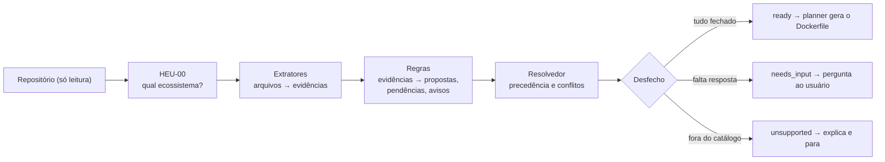

# 01 — O motor por dentro

O motor é um **pipeline em três etapas**: extrair evidências → aplicar regras → resolver. O arquivo central é `analyzer.go` (370 linhas); vale ler ele inteiro uma vez com este roteiro ao lado.



## 1. A porta de entrada: `Analyze` (`analyzer.go:31-49`)

Decide **qual catálogo** usar, antes de qualquer regra:

| Linhas | O que faz | Por quê |
| --- | --- | --- |
| `32` | `detectEcosystem(fsys)` olha marcadores na raiz (`ecosystem.go:33-52`) | Um repositório pode ser Node, Python ou os dois |
| `33-37` | Se o usuário já respondeu "javascript" ou "python" (override `ecosystem`), obedece; o `withComponents` recebe essa escolha para o mapa do repositório descrever **a parte certa** da pasta | Resposta do usuário vence a detecção. Desde a DEC-53 F, uma aplicação que divide a pasta com outra **carrega esse override em todo deploy**, e o `Survey` já as propõe separadas |
| `38-39` | Marcadores dos dois ecossistemas na mesma pasta → devolve a **pergunta HEU-00** | Não dá para adivinhar se o `package.json` é da aplicação ou só de ferramentas (Tailwind, por exemplo) |
| `40-41` | Só Python → `PythonCatalog()` | |
| `42-47` | Nada na raiz (nem marcadores, nem `index.html`) → procura aplicações em subpastas (`findSiblings`); se achar, devolve `monorepoResult` | Repositório com `frontend/` e `backend/` |
| `48` | Caso contrário → `NodeCatalog()` | O catálogo JS também cobre estático e Bun |
| `51-59` | `withComponents` acrescenta o **mapa do repositório** ao resultado | Alimenta o painel (papel de cada peça) e o `Survey` |

## 2. O miolo: `analyzeWith` (`analyzer.go:88-176`)

`Input` (`analyzer.go:19-26`) carrega, além dos `Overrides`, dois campos **opcionais** da DEC-53 G: `Repo` (a raiz do repositório) e `Dir` (o diretório da aplicação nele). Servem só para a recusa dizer onde está um lockfile que fica **acima** da pasta (o de um workspace); nada acima da pasta é analisado.

Leia na ordem em que o código executa:

1. **`89` — valida os overrides** (`checkOverrides`, `199-220`). Campo desconhecido ou que não aceita override é erro de quem chamou; **valor inválido vira pendência** e o override é descartado. Cada campo declara um `Validate` (por exemplo `validatePort`, `catalog.go:181`).
2. **`94-104` — extração.** Antes dos extratores, os overrides válidos são entregues à `Extraction` (`x.overrides`, `95`): um extrator só os lê quando a resposta decide **qual arquivo ler** (`requirements_file`, DEC-53 E; e `allow_unlocked`, que decide se a ausência de lockfile é um fato a aceitar, DEC-53 H). Cada extrator do catálogo roda; erro de um aborta. Se `Input.Repo` existe, `extractAncestors` (`ancestors.go`, `101-103`) acrescenta os lockfiles das pastas acima. `x.finish()` devolve evidências e a *cobertura* (arquivos lidos e lacunas).
3. **`121-153` — o laço de regras**, que tem três mecanismos importantes:
   - **Pré-condição (`123-131`)**: `Meta.Requires` lista regras que precisam ter passado. Se a regra anterior declarou `Unsupported` (`150-152`), as dependentes são `skipped` ("pré-condição não satisfeita"). Exemplo: se a HEU-01 diz "não suportado", não adianta a HEU-02 reclamar de `scripts.start`.
   - **Posse de campo (`138`, `checkOwnership` em `256-271`)**: uma regra só pode escrever nos campos listados em `Meta.Fields`. Se escrever em outro, a análise **falha com erro**. Isso impede que regras se atropelem e deixa a rastreabilidade limpa: cada campo tem exatamente uma regra dona.
   - **Carimbo (`stamp`, `187-194`)**: toda pendência/conflito/aviso sai marcado com o ID da regra que o gerou (é por isso que as mensagens começam com "HEU-0X:").
4. **`157-162` — heurísticas fora do laço**: persistência (DEC-41) e necessidade de serviços (HEU-06) são funções do catálogo, chamadas depois das regras porque precisam das variáveis de ambiente já descobertas pela HEU-09.
5. **`164-165` — o resolvedor** (`resolve`, abaixo). `supported := len(res.Unsupported) == 0`.
6. **`167-174` — o desfecho**: `unsupported` se há qualquer item não suportado; `needs_input` se sobrou pendência ou conflito; senão `ready`.

## 3. A precedência (`analyzer.go:273-348`)

```
override do usuário  >  declaração  >  plataforma  >  inferência  >  default
```

- `originRank` (`273-278`): declaração=4, plataforma=3, inferência=2, default=1.
- `resolve` (`284-348`), campo a campo:
  - **`296-300`**: se há override válido, ele ganha e guarda as propostas que ele sobrescreveu (`Overrode`) para o painel mostrar "você mudou isto".
  - **`304`**: senão, `pickProposal` (`350-375`) fica só com as propostas **do nível mais alto**. Se sobrar mais de um valor diferente nesse nível, devolve **conflito** (`368-372`): "valores incompatíveis para X: a | b". Não existe "o último vence".
  - **`312-317`**: uma pendência de um campo que o usuário já respondeu é descartada.
  - **`322-346`** (`fillRequired`): campo **obrigatório** sem valor e sem pergunta aberta ganha uma pendência genérica. Só dispara se a regra dona do campo **ainda não perguntou outra coisa** (`342`, `asked[owner[...]]`), para não perguntar "qual o comando?" quando a pergunta real é "npm ou bun?".

**Por que essa ordem?** É a RN-03. *Declaração* (o projeto diz explicitamente, como `scripts.start` ou o `WSGI_APPLICATION`) vale mais que *inferência* (o motor deduziu de um padrão) porque a declaração é a intenção do autor. *Plataforma* (a porta 8080) fica entre as duas: é contrato da plataforma, não do projeto.

## 4. Evidências e extração (`extraction.go`)

- **Tipos de evidência** (`15-53`): `kindManifest`, `kindLockfile`, `kindScript`, `kindEnvReference`, `kindDependency`... Cada extrator emite os seus.
- **`Extraction.emit` (`71-75`)** grava a evidência num mapa indexado pelo ID. O ID é um hash SHA-256 truncado de `(extrator, tipo, nome, valor, arquivo, linha, escopo)` (`108-112`): **a mesma observação dá o mesmo ID**, então duplicatas se fundem e o resultado é determinístico (RNF-01).
- **`finish` (`82-106`)** ordena evidências e lacunas por critérios estáveis: o mesmo repositório gera sempre o mesmo resultado, byte a byte.
- **`readSmallFile` (`125-146`)** é a barreira de segurança de toda leitura:
  - não segue **links simbólicos** (`134`);
  - ignora o que não é arquivo regular (`136`);
  - recusa arquivo acima de **1 MiB** (`138`, `maxFileSize` em `55`);
  - devolve um estado (`fileMissing`, `fileSymlink`, `fileTooLarge`) e o extrator registra uma **lacuna de cobertura** (`x.gap`), em vez de fingir que não existe.
- **Lacuna ≠ ausência.** Se um arquivo não pôde ser lido, a regra de porta diz isso na mensagem (`rules_node.go:309-311`: "N arquivo(s) não puderam ser lidos"). É o princípio "ausência de detecção não é prova de ausência".

## 5. Overrides e a API (`analyzer.go:199-252`)

`CheckOverrides` valida as respostas do usuário **antes** de a API aceitá-las, contra todos os catálogos (a escolha do ecossistema pode vir junto com respostas do outro). É validação estrutural: "é uma porta entre 1 e 65535?", não "a porta certa?". Se o valor funciona, só o build e a execução dizem.

## 6. Garantias de segurança da análise (RN-08)

| Garantia | Onde |
| --- | --- |
| Nada do repositório é executado | Todos os extratores usam `fs.ReadFile`/regex; o cabeçalho de `analyzer.go:1-4` registra |
| Links simbólicos não são seguidos | `extraction.go:134`; `configvars.go:122-125` |
| Pastas de dependências e de ambiente virtual são puladas | `skippedDirs` (`configvars.go:23`), `pySkippedDirs` (`python_extract.go:68-72`) |
| Python: no máximo 3000 arquivos | `python_extract.go:74`, `358-361` |
| Valor de variável de ambiente não sai da análise | `envfiles.go:86-88`; `envclass.go:118-120` ("só o tipo sai daqui") |
| Acesso dinâmico (`process.env[x]`) vira lacuna, não suposição | `configvars.go:37`, `142-144` |
| Os caminhos que o usuário ou o repositório escolhem entram em Dockerfile só depois de validados | `validateRequirementsFile` (`rules_python.go:88-96`: relativo, `.txt`, sem `..`), `djangoDirPattern` (`planner/python.go`: um ou dois segmentos simples), `cleanOutDir` (`static.go`) |
| Procurar lockfile acima da pasta só confere se o arquivo **existe**; nada é lido nem executado | `ancestors.go:23-38` |
| Arquivo de variáveis referenciado por um script só é **conferido**, nunca lido | `emitMissingEnvFiles` (`manifest.go:211-229`) |

## 7. Como ler uma regra (modelo mental)

Toda regra segue o mesmo formato (`catalog.go:62-74`):

```go
Rule{
  Meta:  RuleMeta{ID, Version, State, Requires, Fields},   // identidade e permissões
  Apply: func(in RuleInput) RuleOutput { ... },            // função pura
}
```

`Apply` recebe as evidências (`in.Of(kind)`, `in.Named(kind, name)`; `catalog.go:42-60`) e os overrides, e devolve **propostas, pendências, conflitos, não-suportados, variáveis e avisos**. Sem efeitos colaterais, sem I/O: por isso é testável com tabelas e reproduzível.

**Receita para explicar qualquer regra na banca:** (1) quais evidências ela lê; (2) quais campos ela é dona; (3) em que casos propõe, pergunta, avisa ou recusa; (4) qual a origem da proposta (declaração vs inferência) e por quê.
